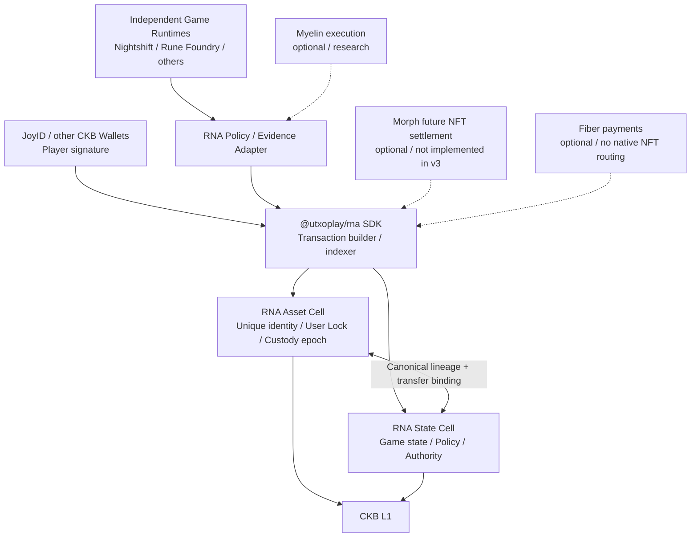
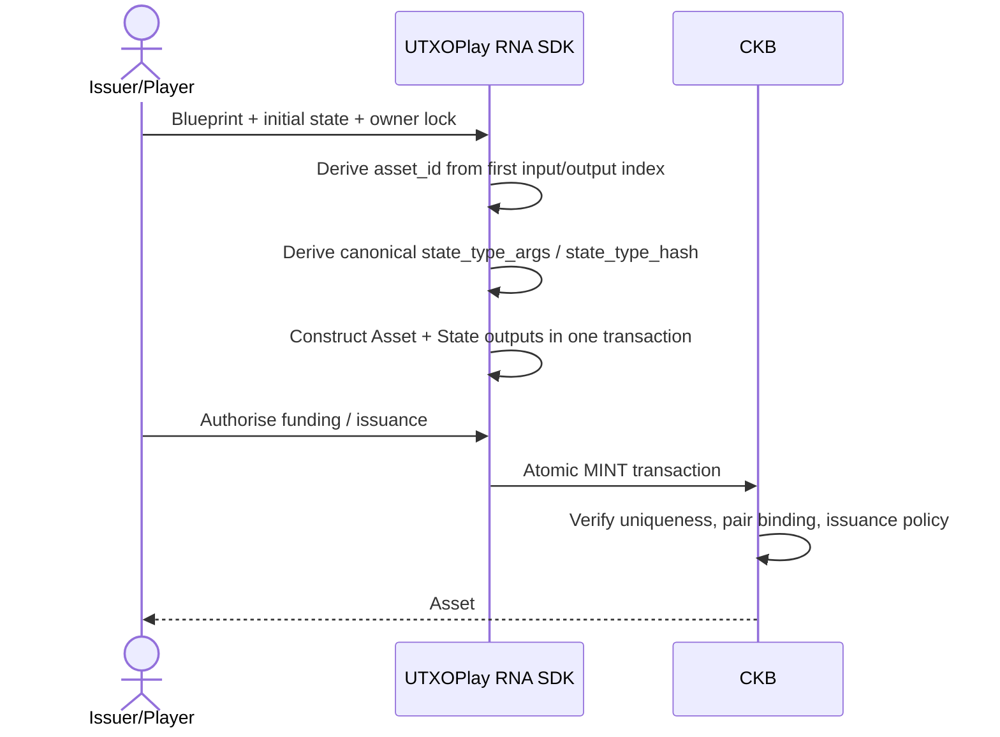
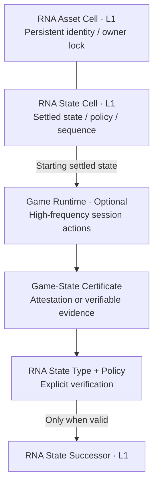
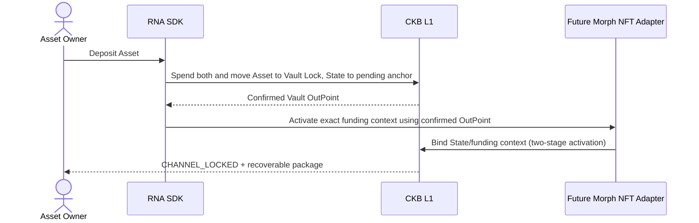

# RNA Protocol / 0 — CKB-Native Game Assets and State Protocol

**Reactive Non-Fungible Artifacts**  
**Subtitle:** A CKB-native protocol for game asset identity, evolving state and enforceable rights  
**Position:** An independently open-source asset protocol natively supported by UTXOPlay and available for adoption by other games  
**Document class:** RFC / Architecture & Security Specification  
**Status:** Draft 0.2 — design clarification, **not** a production deployment standard  
**Date:** 1 November 2026  
**Implementation direction:** Dual-Cell RNA Native (initial profile); persistent L1 NFT; optional Game Sessions; Morph-aware but Morph-independent

> **The central proposition:** A game asset should possess an independent, transferable on-chain identity whilst allowing its dynamic state to evolve under verifiable rules without moving the underlying asset. Ownership authority and evolution authority may be distinct, but the ultimately enforceable State lineage and exit rights must not conflict.
>
> **RNA does not require a proprietary ownership Lock. The asset's Type Script enforces asset invariants; its Lock Script authorises spending.**

---

## 0. Executive Summary and Architectural Decision

This RFC adopts a **dual-Cell RNA Native model**, independent of Spore:

- **RNA Asset Cell:** identifies a unique game asset using a dedicated RNA Type Script, preserving an immutable definition commitment, the identity of its authoritative State lineage, and its ownership/custody epoch. It uses an existing wallet's CKB Lock, including JoyID-compatible Locks, and does not require a proprietary owner Lock.
- **RNA State Cell:** uses an RNA State Type Script deterministically bound to the asset to maintain evolving attributes, rule versions, game authorisations, State sequence numbers and the final settlement anchor. A dedicated State Lock supports constrained game updates, asset-linked transfers and settlement paths.
- **RNA Policy Verifier:** establishes whether an action is permissible under game-specific rules. The protocol explicitly distinguishes operator attestation, L1 rule verification and validity/dispute proofs; these must not be conflated with trustlessness.
- **UTXOPlay SDK:** handles queries, indexing, transaction construction, evidence assembly, signature co-ordination, simulation and presentation. It may build on CCC Core and the JoyID Signer, **without requiring changes to the underlying CCC or JoyID protocols**.
- **Execution / Settlement Adapters:** optionally integrate with Myelin, Morph and Fiber. The initial RNA/0 profile operates independently on L1. Morph-based NFT custody and non-cooperative exits remain future extensions; current Morph v3 must not be represented as already supporting them.

**Principal choice:** The initial RNA/0 profile maintains one independent, persistent State lineage per asset rather than a shared Merkle root. A future RNA/Merkle Profile is possible, but must provide a single authority, data availability and proofs of safe exit.

**Non-goals:** RNA does not depend on, or promise compatibility with, Spore/DOB/Mutant; does not rebuild CKB wallet or private-key custody infrastructure; does not require every in-game item or gameplay tick to go on-chain; and is not a general fungible-token protocol, game engine, routing network or deployed L2. **A Game Session is merely an optional execution optimisation: it does not make an RNA asset or its authoritative L1 State ephemeral.**

## 1. Requirements Derived from UTXOPlay

UTXOPlay is a browser-based game store and publishing/launch platform. Game logic runs in independent game services; Myelin provides execution and replayable evidence for some games; the store handles discovery, accounts, purchases and publishing. Existing in-game items and game-purchase entitlements do not automatically constitute transferable on-chain NFTs.

RNA adoption SHOULD be **opt-in**:

| Scenario | Appropriate representation | RNA/0 responsibility |
|---|---|---|
| Ordinary levels, collisions, character positions | Game runtime / Myelin | No RNA required |
| Gold, mass-market consumables | Fungible token or game ledger | Do not require an RNA asset per unit |
| Persistent racing cars, unique weapons, rare pets | RNA Asset + State | Identity, ownership, state, upgrades, trade |
| In-game upgrades, durability and experience | Game State | Put only materially persistent state in RNA; keep high-frequency changes in the runtime |
| Player-to-player item transfer | Joint RNA L1 transaction | Atomic hand-over of asset and authorisations |
| Depositing an item into a Morph channel | Custody plus settlement evidence | Future Morph adapter; not a capability implemented by RNA/0 |
| Viewing items across games | UTXOPlay Inventory | Distinguish ownership, use, custody, pending settlement and trustworthy state |

The product objective is not another wallet. It is to let holders of existing wallets use, upgrade, sell and recover game assets.

## 2. Terminology and Security Model

- **Asset Identity:** the unique asset identity established by its RNA Asset Type Script and `asset_id`.
- **Current Custodian:** the party or mechanism controlling the actual RNA Asset Cell Lock; under custody, this may be a Morph Vault rather than the ultimate economic beneficiary.
- **Beneficial Claimant:** the party with a redeemable claim under a custody or channel arrangement, determined by the execution domain's settlement state.
- **State Lineage:** the unique succession chain of RNA State Type Script instances currently accepted for an asset.
- **State Authority:** an authorisation path permitting game-state updates within defined limits; not automatically equivalent to ownership.
- **Policy:** a verifier, identified and versioned, that defines valid state transitions.
- **State Commitment:** a hash commitment to canonically encoded game-state bytes; not a proof of data availability.
- **Game Revision:** the revision of the game state; it may advance off-chain and jump when finally settled on L1.
- **State Sequence:** a counter incremented once for each L1 RNA State successor, including transfers, delegations and settlements that do not alter game attributes.
- **Ownership Epoch:** the generation counter advanced when the RNA Asset's actual Lock/custody state changes, mirrored in the State Cell.
- **Funding Context:** the context binding a particular Morph custody arrangement to its exact Vault OutPoint. Replacing a Vault requires a new context.

### 2.1 Three Verification Profiles

| Profile | What is verified | What is **not** guaranteed |
|---|---|---|
| `ATTESTED` | A designated operator or committee correctly signed the outcome | That the game outcome itself is independently correct |
| `SCRIPT_VERIFIED` | An L1 Policy Script carried out the prescribed verification of evidence | That game inputs are authentic or available, unless independently established |
| `PROOF_VERIFIED` | The declared proof/dispute system and L1 verifier satisfied their prescribed conditions | Freedom from data-availability, setup or exit-availability risks |

All clients MUST display the specific Profile. A merely signed game result MUST NOT be presented as ‘fully trustless’.

## 3. System Layers



**Mandatory separation:** RNA's `Asset` and `State` are two CKB Cells at the asset-domain layer. Morph's `Vault` and `State Header` belong to channel custody and settlement evidence. These two pairs must not be confused.

## 4. Authorities and Invariants (Normative)

MUST, MUST NOT and SHOULD below are used as normative requirements in the RFC sense.

**I-01 — Unique identity.** Each `asset_id` may have only one valid RNA Asset Type successor lineage. The RNA Asset Type MUST verify a non-replicable Type ID-style derivation at genesis (first transaction input plus Asset output index), permit exactly one matching Type Script input and one matching output on ordinary continuation, and implement explicit termination rules.

**I-02 — Atomic genesis binding.** Each newly created RNA Asset MUST be accompanied, in the same transaction, by exactly one matching authoritative RNA State lineage. Both scripts MUST cross-check the full Type Script identity of their counterpart, the references in Cell data and the genesis conditions. No party may subsequently create a second ‘authoritative’ State for an existing asset.

**I-03 — Immutable identity.** The Asset's `asset_id`, `definition_commitment`, original issuer identity and `state_type_hash` MUST remain unchanged in ordinary successors.

**I-04 — State-only update.** State may evolve without the Asset being spent. In this path, `ownership_epoch` and `custodian_lock_hash` MUST remain unchanged; `state_sequence` MUST increase by exactly one; and changes to attributes or permissions MUST pass Policy verification.

**I-05 — Coupled Asset spending.** Every spend of an RNA Asset, including Lock replacement, custody entry and re-anchoring without an ownership change, MUST consume its exact matching current State Cell in the same CKB transaction, and produce a successor allowed by the stated action, or terminate both under a formally specified Burn/termination path. The Asset Type MUST verify the existence, uniqueness and identity of the relevant State inputs and outputs.

**I-06 — Atomic authority hand-over.** Transfers and custody changes MUST synchronise the State's `ownership_epoch`, actual `custodian_lock_hash`, authorisation revocation and `last_event_hash`. An off-chain authorisation issued by the previous owner MUST NOT remain valid for the new epoch.

**I-07 — Separation of powers.** Game-state update authority alone MUST NOT allow modification of the RNA Asset Lock, replacement of the Asset Type or termination of the Asset. The State Lock's game-update and asset-linked paths MUST have separate permissions.

**I-08 — Rule/version integrity.** Each action MUST bind `chain_id`, `asset_id`, `state_type_hash`, `policy_hash`, action kind, input state, `state_sequence`, `ownership_epoch` and an expiry/nonce. Policy upgrades MUST use an explicitly authorised migration path.

**I-09 — Single enforceable finality.** In a supported channel execution mode, a frozen/locked L1 State MUST NOT coexist with a channel state offering an independently redeemable competing right. Non-cooperative exit MUST select one final claim under a unique authoritative state-selection rule.

**I-10 — Data availability.** A `state_commitment` without its payload and proof MUST NOT be represented as a complete, independently recoverable game-asset state. The SDK MUST label missing evidence and unverifiable states.

**I-11 — Custody is not ownership.** A change in the `Current Custodian` Lock does not invariably represent a transfer of beneficial ownership, for example when entering a Vault. A platform MUST NOT display the Vault custodian as though it were the beneficial player-owner.

**I-12 — Safe exit.** Where an execution mode promises exit without operator co-operation, its deployment MUST provide actually usable L1 verification scripts, an authoritative selection rule, complete exit evidence and the relevant deadline requirements. A runtime signature alone does not satisfy this claim.

**I-13 — State Lock and Capacity integrity.** A State-only update MUST preserve the protected State Lock identity and the State Cell's carrier Capacity, unless it uses an explicit, authorised migration or refund path. A game writer MUST NOT covertly spend State carrier Capacity as fees. Capacity refunds upon termination MUST follow a precommitted rule.

**I-14 — Persistent asset and state.** An RNA Asset MUST retain an independent, unique identity verifiable on L1. Its RNA State MUST preserve an authoritative succession lineage accepted by L1. Closing a Game Session, stopping a runtime or losing an operator MUST NOT automatically destroy the Asset or replace its settled State with a temporary database record.

**I-15 — Owner authority is not evolution authority.** The ordinary `TRANSFER` and `REANCHOR` branches of `ASSET_LINKED` MUST preserve game-attribute commitments, Policy identity and other protected fields that may not be altered in a transfer. An owner's Asset Lock signature MUST NOT, by itself, be interpreted as valid `GAME_UPDATE` evidence. An upgrade combined with a transfer MUST use an explicit compound action and independently pass Game Policy verification.

**I-16 — Game Authority is not Asset spending authority.** A valid game-operator signature or execution proof MUST NOT change the Asset Lock, burn the Asset or create a second redeemable claim without valid Asset Lock authorisation and Asset Type verification. Permission for a State-only update does not entail permission to spend the Asset.

**I-17 — Sessions are only an optional execution layer.** A `SESSION` state, operator attestation, runtime checkpoint or Myelin finality MUST NOT, by itself, replace RNA's canonical L1 State. Every L1 `SESSION_SETTLE` MUST explicitly validate the prior settled state, Policy, game-event evidence and authoritative state-selection rules. Where credible settlement and exit mechanisms have not been deployed, Session Evidence is candidate-state material only.

**I-18 — Do not confuse evidence with recoverability.** A game-operator signature can establish that an operator endorsed a transition, but not that the underlying events were independently authentic. A `state_commitment` commits to a payload but does not make it available. If the full payload, rules or necessary evidence are missing, clients MUST explicitly identify the state as not independently verifiable or recoverable.

## 5. RNA Native Wire Model (Draft Molecule Schema)

**Caution:** The `.mol` below is a design-stage schema sketch. It has not been compiled with `moleculec` or checked for on-chain compatibility. The final release must freeze byte order, hashing domains, version numbers, rules for appending table fields, output-index treatment and Script-identity encoding through reproducible test vectors.

```molecule
array Byte32 [byte; 32];
array Uint16 [byte; 2];
array Uint64 [byte; 8];
vector Bytes <byte>;

// Stored in an RNA Asset Cell's data field.
struct RnaAssetDataV0 {
    version: Uint16,
    definition_commitment: Byte32,
    state_type_hash: Byte32,
    ownership_epoch: Uint64,
    flags: Uint16,
}

// Stored in the unique RNA State Cell for this asset.
struct RnaStateDataV0 {
    version: Uint16,
    asset_type_hash: Byte32,
    domain_id: Byte32,
    state_sequence: Uint64,
    game_revision: Uint64,
    ownership_epoch: Uint64,
    custodian_lock_hash: Byte32,
    state_schema_hash: Byte32,
    state_commitment: Byte32,
    policy_hash: Byte32,
    authority_commitment: Byte32,
    carrier_refund_lock_hash: Byte32,
    execution_mode: byte,
    funding_context_commitment: Byte32,
    last_event_hash: Byte32,
}

// Canonical action metadata; proof bytes are carried in a defined witness slot.
table RnaActionV0 {
    action_version: Uint16,
    action_kind: byte,
    asset_type_hash: Byte32,
    domain_id: Byte32,
    prior_state_hash: Byte32,
    next_state_hash: Byte32,
    policy_hash: Byte32,
    authorisation_digest: Byte32,
    evidence_commitment: Byte32,
    evidence: Bytes,
}
```

### 5.1 Asset Identity

`asset_id = CKB_TYPE_ID_LIKE(tx.inputs[0], asset_output_index)` constructs **RNA's own Asset Type Script args**. This does not put the built-in TYPE_ID script alongside the RNA Type Script on one Cell: a CKB Cell has only one Type Script. The RNA Asset Type MUST itself validate the uniqueness condition.

`asset_type_hash = script_hash(full RNA Asset Type Script)`, whose `args` contain the derived `asset_id`.

`state_type_args = H("RNA_STATE_LINEAGE_V0" || chain_id || asset_type_hash || domain_id)`.

`state_type_hash = script_hash(full RNA State Type Script)`.

Asset Data stores `state_type_hash`; State Data stores `asset_type_hash`. The two Types refer to each other's **Script identities**, not to each other's Data hashes, so their definitions do not introduce circular hashing. In RNA/0, `domain_id` is fixed at issuance to the primary game domain. Cross-game secondary state must not become a competing authoritative RNA Core State lineage.

### 5.2 State, Versions and Custody

Draft `execution_mode` enumeration:

- `0 = L1_ACTIVE`: independent State-only evolution is permitted;
- `1 = DEPOSIT_PENDING`: channel entry has begun, but the Vault OutPoint is not yet activated;
- `2 = CHANNEL_LOCKED`: L1 is frozen, and the currently redeemable state is determined by the bound settlement context;
- `3 = SETTLING`: a non-cooperative exit or dispute is under way;
- `4 = FINAL`: terminal; no further evolution permitted.

`custodian_lock_hash` mirrors the actual Asset Cell Lock. In `CHANNEL_LOCKED` mode it identifies the Vault, not the player's beneficial claim. An off-chain Beneficial Claimant MUST be independently established by channel settlement state.

`state_sequence` counts **L1 successors**, increasing by exactly one for each valid State Cell replacement. `game_revision` records game changes and may skip ahead from the old checkpoint upon final Morph/Myelin settlement, but only with a valid proof. A permitted revision jump is not a licence to omit Game Policy verification.

`definition_commitment`, `policy_hash` and `state_schema_hash` establish hash identities only. They do not guarantee that external data remains available. If UTXOPlay promises long-term rendering, it SHOULD use a defined preservation mechanism or on-chain storage.

`carrier_refund_lock_hash` precommits the legitimate recipient of the State Cell's occupied Capacity upon termination or exit. An ordinary State-only update MUST preserve the State Cell's Capacity exactly, paying transaction fees from other inputs. Asset transfers involving a change in refund recipient MUST be governed by the asset-linked rules.

## 6. Lock and Type Script Responsibilities

### 6.1 RNA Asset Cell

```text
RNA Asset Cell
├── Lock: standard wallet-owned CKB Lock
│   └── JoyID / another supported CKB Signer
├── Type: RNA Asset Type Script
│   └── args = unique RNA asset_id
└── Data: immutable definition + state lineage + ownership epoch
```

- The wallet Lock verifies **who authorises spending this asset**.
- The RNA Asset Type verifies **how the protocol permits this asset to change**.
- The RNA Asset Type need not know the algorithm for upgrading a racing car. It must recognise action kinds, State coupling, enforceable lifecycle rules and the authorisation boundary.
- The owner may not replace the wallet Lock without the matching RNA State transition. A game-server signature alone may not spend the Asset Cell.

### 6.2 RNA State Cell

```text
RNA State Cell
├── Lock: RNA State Lock V0
│   ├── GAME_UPDATE: limited game-policy authority
│   ├── ASSET_LINKED: matching Asset Input + valid Asset Lock
│   ├── CHANNEL_SETTLEMENT: verified settlement proof
│   └── RECOVERY: explicitly precommitted escape policy
├── Type: RNA State Type Script
│   └── args = deterministic state_type_args
└── Data: state commitment + sequence + policy + authorisation
```

- `GAME_UPDATE` MUST NOT alter the Asset Lock, covertly replace the State Lock, extract State carrier Capacity or obtain spending authority over the Asset Cell.
- `ASSET_LINKED` SHOULD NOT require the operator to remain online indefinitely to co-sign. It MUST depend upon the matching RNA Asset Input and Asset Type checks in the same transaction; CKB must independently validate the Asset Input's Lock.
- `CHANNEL_SETTLEMENT` MUST verify the channel's authoritative settlement evidence and the applicable RNA Policy. The mere existence of a signed Header cannot establish a valid game upgrade.
- `RECOVERY` MUST NOT covertly bypass a game's precommitted non-transferability or termination rules. Its powers, delays and exit conditions SHOULD be stated at issuance.

### 6.3 Authorisation Deadlock and Liveness

The State Lock's authorisation scheme must permit **protocol-compliant transfers and exits when the operator is offline**; otherwise, the game operator can freeze player property. A genuinely Soulbound item may deliberately be restricted, but its limits and conditions for release must be explicit.

A further risk is that an operator may continuously publish State-only updates, making an owner's assembled transfer stale through repeated UTXO conflicts. The initial profile MUST acknowledge this liveness problem and SHOULD investigate short-lived freeze intents, time-bounded delegation or transaction-scheduling strategies. It MUST NOT promise a definite adversarial exit latency before those mechanisms are tested.

### 6.4 Ordinary Transfers and Game-State Evolution MUST Be Separate Authorisation Branches (Draft 0.2)

An ordinary holder able to sign for an Asset Cell is not thereby entitled to modify level, wins, durability or other fields governed by a Game Policy. Conversely, an operator authorised to use the State Cell's `GAME_UPDATE` path is not thereby authorised to transfer the Asset Cell.

| Transaction branch | Asset input | State input | Required authorisation | May game state change? |
|---|---|---|---|---|
| `MINT` | None | None | Valid issuance conditions | Genesis state created |
| `GAME_UPDATE` | None | Yes | Game Authority / Policy Evidence | According to Policy |
| `TRANSFER` | Yes | Yes | Owner Asset Lock + `ASSET_LINKED` + Transfer Policy | **No** (ordinary transfer) |
| `TRANSFER_WITH_EVOLVE` (future) | Yes | Yes | Owner plus independent Game Policy Evidence | Only as permitted by the verified compound action |
| `BURN` | Yes | Yes | Owner plus asset-termination Policy | According to termination rules |
| `SESSION_SETTLE` (future, optional) | Profile-dependent | Yes / settlement anchor | Valid session evidence and settlement proof | Only as authorised by the valid settlement result |

Normative requirement: `ASSET_LINKED` MUST bind the exact current Asset's full Type Script identity, valid inputs, State successor and required output commitments. The ordinary `TRANSFER` path MUST enforce `next.state_commitment == previous.state_commitment`, preserve the Policy, advance the ownership epoch, update the Lock snapshot and revoke the required old authorisations. A player's signature and the presence of an Asset Input MUST NOT weaken game-state validity checks.

CKB independently verifies the Lock for the Asset Input. The State Lock need not reimplement JoyID cryptography, but MUST verify the transaction structure and paired Asset; the Asset Type and State Type must enforce the reciprocal security constraints. The exact Witness format and index-matching rules remain to be frozen at M0.

## 7. RNA/0 Core Lifecycle and Transaction Flows

### 7.1 `MINT` — Atomic Dual-Cell Genesis



**Required checks:** The Asset Type genesis group has exactly one output and no matching input; the State Type genesis group likewise has exactly one output and no matching input; both outputs cross-reference the full Script hashes; State genesis cannot be forged during a transfer of an existing Asset. If issuance limits exist, an independent, non-duplicable Issuance Authority or appropriate counter/proof MUST enforce them. A static Blueprint declaration alone is insufficient.

**Important:** Minting an RNA Asset does not automatically mean UTXOPlay provides marketplace support for every NFT on CKB. RNA needs its own indexer and parser. Nor must every game item become RNA.

### 7.2 `EVOLVE` — State-Only Update

```text
Input:   RNA State(seq=17, game_rev=30, epoch=4)
Witness: GAME_UPDATE + policy evidence + authorised digest
Output:  RNA State(seq=18, game_rev=31, epoch=4)

Asset Cell: NOT SPENT
```

Scripts MUST preserve the `asset_type_hash`, `domain_id`, `ownership_epoch`, `custodian_lock_hash` and `state_type_hash` identity. The Policy MUST determine permissible changes to `state_commitment`, `authority_commitment` and `game_revision`. An operator-signature Profile must be clearly distinguished from a proof establishing the truth of a game event.

### 7.3 `TRANSFER` — Atomic Hand-over of Asset and State Authority

```text
Inputs:
  RNA Asset #42   Lock = Alice    epoch = 4
  RNA State #42   owner_lock_hash = H(Alice), epoch = 4, seq = 18

Outputs:
  RNA Asset #42   Lock = Bob      epoch = 5
  RNA State #42   owner_lock_hash = H(Bob),  epoch = 5, seq = 19

Authorisation:
  Alice's normal wallet lock succeeds;
  State Lock ASSET_LINKED path succeeds;
  RNA Asset/State Type Scripts verify one another.
```

- Game-specific transfer restrictions MUST be verified where applicable, for example a precommitted Soulbound flag.
- Game attributes SHOULD remain unchanged in an ordinary transfer. A transaction that also upgrades the item must use an explicit, distinct compound action with complete corresponding Policy Evidence.
- Authorisations from the old `ownership_epoch` MUST become invalid. The use/evolution rights obtained by the recipient depend upon the policy expressly committed at issuance; it must not be presumed that all game permissions automatically transfer.
- A transfer back to the same Lock hash may use `REANCHOR`, but still MUST couple the State transition so as not to bypass identity and custody rules.

### 7.4 `GRANT_USE / REVOKE / DELEGATE`

These change permissions in RNA State without necessarily transferring the Asset. They may specify recipient identity, permitted action sets, allowances or use counts, validity windows, domain scope and authorisation-revocation sequence. Unless the contract expressly supports it, ‘may play the game’ MUST NOT be treated as ‘may transfer the NFT’.

### 7.5 `CONSUME / FORGE / BURN`

The initial RNA/0 release may specify only the safety conditions for `FINALISE` and `BURN`. Complex cross-asset crafting belongs in a later Profile.

Future crafting MUST verify all ingredient Asset inputs, their consumption and termination, authority to issue new Assets, cross-asset supply constraints and the impossibility of redeeming ingredients twice. Burning an Asset MUST also terminate or otherwise resolve its State lineage. It must not leave a live, extendable authoritative State with no Asset.

### 7.6 RNA Remains a Persistent NFT; a Game Session Is Only an Optional Execution Accelerator (Draft 0.2)

**An RNA/0 asset is not an ephemeral NFT.** Its Asset Cell and State Cell together constitute a long-lived game asset that may be held and transferred and whose transitions are constrained by L1. A Session contains ongoing actions and candidate changes not yet settled; it cannot unconditionally override a settled State.

For example:

| Information | Example | Authoritative location |
|---|---|---|
| Unique asset identity | `Sword #42` | RNA Asset Type (L1) |
| Most recently confirmed level | `Level 12` | RNA State (L1) |
| Most recently confirmed enhancement | `+5` | RNA State (L1) |
| Temporary attack bonus during this battle | `+20%` | Game Session |
| Experience pending settlement | `+300 XP` | Session Evidence (candidate) |



Both of the following modes are possible; a game need not adopt Sessions:

**Direct L1 Evolve (core RNA/0 path):** The game submits valid `GAME_UPDATE` authorisation and rule evidence, consumes the State Cell and creates its successor. The Asset Cell is untouched. Every update must pass full State Type/Policy verification.

**Session-assisted Evolve (optional/future Profile):** The game executes several short-lived actions and generates a verifiable record or Game-State Certificate. A suitably authorised transaction submitter later presents `SESSION_SETTLE`, enabling the L1 State Type/Policy to accept a new final state. The evidence must bind the chain, `asset_id`, `state_type_hash`, starting State commitment, Policy, ownership epoch, `session_id`, final State commitment, `game_revision`, nonce/expiry and signing authority. Until this Certificate has been properly validated and confirmed, it is **not** the new canonical L1 State.

`ATTESTED` proves only that the designated Game Authority signed the outcome; **it does not establish that the match was authentic, fair or independently replayable**. The guarantees of `SCRIPT_VERIFIED` and `PROOF_VERIFIED` must be described in terms of their actual verification predicates.

For `SESSION_SETTLE`, the Game Authority may be responsible for **endorsing the result** without itself being required to **publish every L1 State transaction**. Open submission is not permission for arbitrary users to submit fabricated upgrades: the State Type must verify trusted authorisation or genuinely valid evidence.

#### 7.6.1 An Ordinary User Attempts to Forge a Level: MUST REJECT

```text
Asset #42: Alice's JoyID Lock
State #42: Level 12, Policy P, Seq 45

Alice submits:
  Input:  State #42 (Level 12)
  Output: State #42 (Level 99)
  Proof:  only Alice's wallet signature

Expected result: REJECT
```

An ordinary Owner signature establishes authority to spend the Asset, not permission to use the State Lock's `GAME_UPDATE` branch or an exemption from Policy verification. If Alice instead attempts to use `ASSET_LINKED` to circumvent this rule, the ordinary `TRANSFER` path must also require `state_commitment` to remain unchanged.

#### 7.6.2 A Legitimate Player Transfer: Preserve Game State, Hand Over Rights

```text
Inputs:
  RNA Asset #42 → Alice, epoch=4
  RNA State #42 → Level 12, seq=45, epoch=4

Outputs:
  RNA Asset #42 → Bob, epoch=5
  RNA State #42 → Level 12, seq=46, epoch=5

Allowed: Owner-authorised transfer + valid State pairing.
Forbidden:  Level 12 → 99 without separate, verifiable Game Policy evidence.
```

An ordinary transfer may advance `state_sequence` and MUST advance `ownership_epoch`, but it must not arbitrarily alter game state. Evolution authorisations from the previous epoch are invalidated according to the precommitted rules.

#### 7.6.3 What Survives When the Player or Game Operator Goes Offline?

The Asset and its confirmed State remain verifiable and holdable on CKB. Unsettled experience, loot and match outcomes may be described as independently recoverable **only** if the user has the complete necessary evidence and there is a deployed, executable settlement path. A hash without payload, signatures and required rule material cannot support a promise of full progress recovery.

#### 7.6.4 Non-Cooperative Exit and Third-Party Rights

If a Session has generated enforceable economic claims for third parties, the player cannot unilaterally revoke those claims simply by restoring an old State. A final-state selection/dispute mechanism accepted in advance by the relevant parties and enforceable on L1 is required. RNA/0 does not claim to have deployed such a mechanism, nor does it treat Myelin's internal finality as equivalent to L1 settlement finality.

## 8. Consistency, Concurrency and Cross-Cell Constraints

**8.1 Asset Type MUST enforce State coupling.** Checking only ‘I reference this `asset_id`’ in the State Type is insufficient. Whenever an Asset Type is spent, it MUST locate the current State input and its valid successor, and reject any Asset spend lacking the required State transition.

**8.2 State-only transitions cannot query the current Asset across the entire chain.** A CKB Script cannot arbitrarily query the network's latest UTXO by Asset ID. State-only evolution therefore relies on the `ownership_epoch` / `custodian_lock_hash` snapshots and unique State Type lineage, whose coherence must have been enforced by the Asset Type. If an Asset has ever been able to bypass its synchronisation path, that is a protocol failure, not something for an indexer to ‘repair’.

**8.3 UTXO concurrency.** State Cells belonging to distinct assets may evolve in parallel. Updates to the same asset must still be serialised because they consume the same current State UTXO. Dual Cells do not provide unlimited same-asset concurrency.

**8.4 Writer Racing.** If the Game Authority has unbounded permission to spend the L1 State Cell directly, it can in principle compete continuously with an Owner's transfer for the same UTXO. A Certificate model, in which the Game Authority signs outcomes and other participants publish them, can reduce the runtime's need to write directly to the chain, but **does not automatically resolve** competing valid submitters or stale-state conflicts. Scheduling preferences, retries and indexer improvements may help usability, but are not L1 guarantees against censorship or of a deterministic exit time. The initial profile MUST document this risk and include adversarial tests; liveness in an adversarial environment requires an independently justified mechanism. This RFC does **not** adopt a model requiring users to replenish an update quota every N actions as the default core path.

**8.5 Combining operations.** `EVOLVE`, `TRANSFER`, `DEPOSIT`, `SETTLE`, `BURN` and similar operations MUST use canonical action labels and strict parsing. The same Witness must not be reinterpretable as a weaker authorisation path.

## 9. Morph-Aware Settlement Profile (Future Extension; Not Implemented by RNA/0)

### 9.1 Principles

Morph separates its Vault (actual asset custody), State Header (evidence for the latest enforceable channel state), and Sponsor (fee funding). Its current v3 research implementation supports bounded CKB and CKB-plus-one-xUDT settlement on a local devnet, as well as Factory Merkle rights. **It does not yet provide an RNA NFT-aware Vault or Settlement Descriptor.**

**The RNA State Cell is not the Morph State Cell.** The former describes a game asset's L1 state; the latter supports selection of channel claims and settlement evidence.

### 9.2 Channel Entry: `L1_ACTIVE → DEPOSIT_PENDING → CHANNEL_LOCKED`



A newly created output's OutPoint consists of its transaction hash and output index. A deposit transaction cannot assume its own final Vault OutPoint and commit that value into data contributing to its transaction hash without creating a circular dependency. A staged process compatible with Morph's existing two-stage Vault activation should bind the confirmed, actually existing Vault OutPoint. Pending, unactivated deposits must have an audited timeout cancellation/recovery path; they must not become permanently frozen.

In `CHANNEL_LOCKED` mode, the L1 State Cell MUST prohibit independent `GAME_UPDATE`. Morph state may commit to `beneficial_claimant`, `game_state_commitment`, `game_revision` and `policy_evidence_commitment`. These values must bind the `asset_id`, Funding Context, State Number and channel participants.

### 9.3 State Transitions Within a Channel

```text
Vault: Asset #42 (remains locked)
RNA L1 State anchor: game_rev = 10

Morph signed state #100: claimant=Alice; game_rev=10
Morph signed state #101: claimant=Alice; game_rev=11
Morph signed state #102: claimant=Bob;   game_rev=11
Morph signed state #103: claimant=Bob;   game_rev=12
```

Morph establishes **which channel state may ultimately settle**. RNA Policy establishes **whether the game state evolved legally**. Neither verification discharges the other's responsibility. Where operator signatures are used, the guarantee is limited to an outcome endorsed by that operator, not independently replayed validity.

### 9.4 Exit: Cooperative and Non-Cooperative

- **Cooperative Close:** With participant authorisation, atomically return the RNA Asset and new RNA State under a bounded, enforceable settlement descriptor. This is not a capability to be presumed available in Morph v3.
- **Disputed Close:** Execute valid State Publication/Supersession/Challenge before settling the RNA Item and State once the latest enforceable state has been selected. A watchtower must hold the latest state and all necessary evidence.
- **No Double Exit:** An old L1 State must not coexist with a final Morph claim that can redeem the same item independently. Once the asset has exited, the old Funding Context may not be used to claim it again.
- **Exact Materialisation:** The full resulting RNA Asset Type, Lock, Data and State evidence must match the signed settlement rules exactly. Comparing only an item name, Type label or unverified hash is insufficient.
- **Data Availability:** A legitimate holder must be able to reconstruct the complete evidence needed for exit while another party is offline. Otherwise, non-cooperative safe exit must not be promised.

### 9.5 Capabilities Required in a Future Morph v4

1. A bounded Multi-Cell / Typed Vault Set, or an auditable RNA-specific Vault Profile.
2. A `NonFungibleAssetDescriptor` covering exact asset identity, State lineage, claimant, final Policy and output material.
3. An RNA state-settlement verifier establishing legal game-revision evolution, or explicitly declaring the applicable trusted verification Profile.
4. A unique claim to each NFT identity and exact materialisation.
5. Factory NFT Rights, if adopted; an RNA asset must not be represented as a fungible `u128` amount.
6. Tests for non-cooperative close, State Supersession, reorganisations and independent watchtower recovery.

The current Factory's quantity-based rights tree must not simply be relabelled as NFT support. Sparse Merkle Proof machinery may be reused, but identity uniqueness, authority hand-over and exit proofs cannot be omitted.

## 10. Myelin Adapter (Execution Interface, Not a Completed On-Chain Court)

Myelin orders, executes and preserves Cell-state transitions and their evidence during finite execution sessions. Its research implementation offers CKB-VM verification, checkpoints and evidence stages, but a complete public-network data-availability, court and settlement path has not been deployed as a trustless L1 mechanism.

The RNA/Myelin Adapter SHOULD expose:

```text
rna.asset_id
rna.state_type_hash
rna.domain_id
rna.input_game_revision
rna.output_game_revision
rna.action_digest
rna.policy_hash
rna.execution_receipt_commitment
rna.checkpoint_root
rna.exit_proof_reference
```

`Myelin-finalised` MUST NOT be treated as synonymous with `CKB-enforceable`. A deployment permitting an RNA Asset to exit Myelin must implement asset custody, valid state selection, proofs, data availability and an exit package available to the user.

## 11. Fiber Adapter (Payment Interoperability, Not a Claim of NFT Routing)

RNA's initial, well-defined integration with Fiber is **payment**, not ‘native multi-hop NFT transfer through Fiber’:

- Fiber provides CKB/FT payments. RNA Assets are delivered through L1 custody or a separate, trusted settlement mechanism.
- If conditional delivery uses a shared preimage, the protocol must verify timeout paths, refund ordering, early claims, the correct purchaser output, reorganisations and preimage visibility.
- Multi-hop transfers across independent NFT channels still require verifiable transfer of the final custody claim, cancellation of old exit rights and atomic hand-over. A shared preimage alone does not establish these properties.

Fiber is well suited to payment liquidity; Morph is a potential research direction for future RNA asset custody and settlement. The two have different security responsibilities.

## 12. UTXOPlay SDK, JoyID and CCC

Suggested package structure:

```text
packages/
  rna-core/         # pure types, Molecule codecs, hashes, identity
  rna-policy/       # policy/evidence interfaces and conformance vectors
  rna-ckb/          # CCC Transaction builders and chain queries
  rna-joyid/        # thin signer integration; optional
  rna-inventory/    # ownership, rights, unresolved state UI model
  rna-morph/        # future settlement adapter (experimental)
  rna-myelin/       # execution evidence adapter (experimental)
contracts/
  rna-asset-type/
  rna-state-type/
  rna-state-lock/
  rna-policy-verifiers/
schemas/
tests/
docs/
```

**Signing responsibilities:** The Asset Cell uses the player's existing JoyID/CKB Lock. The State Cell uses a separate, restricted State Lock. The Asset Type's mandatory Asset/State coupling is wallet-independent. `@utxoplay/rna` may use `@ckb-ccc/core` to construct custom transactions and existing JoyID CKB Signers to authorise them; neither CCC nor JoyID needs a new RNA-specific consensus rule.

**Witness conflicts:** JoyID's `sub_key` path may place COTA SMT unlocking data in the wallet Lock's `WitnessArgs.outputType`. RNA MUST define a separate, reproducible Witness placement and signature-coverage scheme for its Actions/Evidence, without overwriting existing JoyID fields. Signing stages must not silently change other Witness material covered by a signature. Multi-party signing requires a deterministic assembly order and testing on real devices.

**JoyID boundaries:** Browser pop-ups, Passkey interactions and device-specific modes entail practical constraints. RNA's L1 safety must not assume that JoyID remains continuously online to sign every game action. Game Session authorisation is different from spending an on-chain asset.

**Indexer:** UTXOPlay MUST discover the Asset Cell and unique current State Cell, validate Type Script identities, epoch and data commitments, and classify states such as L1-owned, Delegated, Custodied, Disputed and Evidence missing. The indexer provides discovery and presentation; it does not determine chain validity.

**Store responsibilities:** The store supplies game entry points and a general Inventory. It does not hold player private keys, execute independent games' rules on their behalf or require every game to adopt RNA.

## 13. Security Threat Model and Negative Cases

| Attack | Initial defence / mandatory test |
|---|---|
| Mint a duplicate Asset ID | Asset Type ID-style unique genesis; first input cannot be reused |
| Forge a second State lineage for an existing Asset | State genesis must coincide with Asset genesis and enforce reciprocal binding |
| Owner transfers Asset alone, leaving old game authority | Asset Type requires an atomic State input and successor |
| Game operator transfers Asset via State Lock | State-only path excludes Asset input; independent Asset Lock verification and Asset Type restrictions |
| Game uses Alice's old authorisation to update Bob's item | `ownership_epoch`, State sequence, nonce and domain separation |
| Game Authority arbitrarily changes attributes | Explicit Policy validation; identify the trusted source where the Profile is attested |
| Malicious State update competition prevents transfer | Exercise racing conflicts, cancellation/freeze requests and recoverable authorisation strategies |
| Replace `policy_hash` to circumvent Soulbound restrictions | Fixed upgrade path, explicit authorisation and validated version migration |
| Asset is burned but its State remains live | Burn must terminate the paired State and resolve all claims |
| An L1 state and channel state independently redeem an asset under custody | `CHANNEL_LOCKED`, Funding Context and unique final consumption |
| Morph force-closes with a stale state | Latest signed-state supersession, valid challenge window and watchtower |
| Submit only a hash and withhold State payload | DA/receipt requirements and unverifiable-state warnings; no unsupported exit promise |
| Extract CKB Capacity or mix Sponsor accounting into asset value | Exact State-only carrier conservation; explicit refunds; separate Asset, Reserve, State carrier and Sponsor accounting |
| Reinterpret a Witness as a weaker authorisation | Versioned action encoding, full parsing and signing-domain separation |
| Accept a confirmation invalidated by a CKB reorganisation | Canonical-block checks, confirmation policy, State rollback and reconstruction |

## 14. Minimum Test Matrix (Acceptance Gates)

### Gate A — L1 Genesis and Uniqueness

- **A01:** Atomically mint both Cells and parse them using an independent client.
- **A02:** Reject duplicate `asset_id`, duplicate State lineage and two outputs within a single Script group where disallowed.
- **A03:** Reject a State genesis that references the Asset output of a transfer of an existing Asset.
- **A04:** Reject incorrect `chain_id`, Type Script code hash, definition or Policy identity.
- **A05:** Where an issuance cap is specified, prevent over-issuance under concurrent mint attempts.

### Gate B — State Update and Authority

- **B01:** A valid game action performs a State-only update while the Asset OutPoint remains unchanged.
- **B02:** Reject skipped State sequence numbers, replay of old State, incorrect epoch and invalid attribute transitions.
- **B03:** The operator cannot change the Asset Lock, replace the State Lock, extract carrier Capacity, burn the Asset or modify State outside its authority.
- **B04:** The owner-linked State Lock path works without an online operator signature and cannot be abused independently.
- **B05:** Record the recovery and progress bounds for an owner transfer under continuously racing State updates by the operator.
- **B06:** Reject a `Level 12 → Level 99` `GAME_UPDATE` submitted with only the player's JoyID/Owner signature.
- **B07:** Reject an ordinary `ASSET_LINKED` `TRANSFER` that also tampers with `state_commitment`, Policy or game revision.
- **B08:** Reject attempts by an operator with valid `GAME_UPDATE` evidence to change the Asset Lock, burn the Asset or extract State carrier Capacity.
- **B09 (future Session Profile):** Accept a `SESSION_SETTLE` with the correct anchor and evidence; reject stale epochs, incorrect starting States or forged Game Certificates.
- **B10 (future Session Profile):** Do not misrepresent operator-offline, missing-State-payload, competing-Certificate or third-party-claim scenarios as already supporting non-cooperative exit.

### Gate C — Ownership / Lifecycle

- **C01:** Complete genuine transfers using JoyID primary-key and Sub-key signatures respectively.
- **C02:** Reject an Asset transfer that does not consume the matching State.
- **C03:** Check exact consistency of new Lock, State's Lock snapshot, ownership epoch and revoked authorisations.
- **C04:** Ensure the previous holder's authorisations become invalid after transfer.
- **C05:** Cover positive and negative Soulbound, delegation, revocation, expiry and Burn cases.
- **C06:** Simulate multiple Lock Groups, Witness assembly order and signature integrity.

### Gate D — Performance / Security Comparison

Implement the same item behaviour using **Single-Cell RNA, Dual-Cell RNA and Spore + RNA-managed Lock** as controls:

- Minting, game upgrades, transfers, Burn and custody entry.
- Transaction size, Witness bytes, Cell Capacity, VM cycles, source line count and independently auditable trust boundaries.
- Parallel update capacity across assets, contention within an asset and player signature count.
- Exceptional recovery, malicious operators and chain reorganisations.

**No measurement results exist yet; it is impermissible to assume that Dual-Cell RNA is cheaper or faster.**

### Gate E — Morph-Aware Design Acceptance (Extension Objective)

- **E01:** Deposit pre-activation, post-confirmation OutPoint binding and recovery of unactivated deposits.
- **E02:** Off-chain evolution and beneficial-claimant transfer after the L1 State is frozen.
- **E03:** Publication of old states, supersession by newer states and confirmation delays during non-cooperative close.
- **E04:** Exact generation of Asset + State on exit; prevent redemption of the same old rights again.
- **E05:** Demonstrate actual player/watchtower recovery where the operator withholds State data.
- **E06:** Validate identity-based rights for multiple assets in one Vault Set and Factory Merkle structures.

Gate E depends on new Morph contracts and is not part of the acceptance criteria for RNA/0's first independent release.

## 15. Issuance, Contract Upgrades and Governance

**Keep the trusted core minimal.** `rna-asset-type` fixes the asset invariants. Game rules belong to an explicitly committed Policy Verifier. The game operator must not be able to substitute the code Cell of a Type-ID-referenced verifier to bypass existing assets' transfer, identity and exit guarantees.

**Make version upgrades explicit.** A future `RNA/1` must not silently reinterpret the byte semantics of `RNA/0`. Cross-version migrations must validate both old and new identities and the rights involved. If dynamic code references are used for upgradeable contracts, their deployment SHOULD have auditing, delay and an exit route that protects holders.

**Provide verifiable reference implementations.** Supply semantically equivalent Rust and CellScript test vectors, Molecule golden vectors, Script-hash identities and negative cases for every Action. All real-asset deployments require independent auditing and network-level validation.

**Do not bind assets to a UTXOPlay account.** If UTXOPlay stops operating, a player should still be able to use the CKB Lock and public RNA contracts to verify an asset, transfer it where the Policy allows, obtain available State payloads and exercise recovery paths actually supported by deployed contracts. Where a capability depends on a game operator, that trust boundary must be explicit.

## 16. Deliverables, Milestones and Priorities

| Stage | Required deliverable | Completion criterion |
|---|---|---|
| M0 — Specification freeze candidate | Molecule, Action table, Script args, hashing domains, state machine | Reproducible specification and test vectors |
| M1 — Asset/State L1 | Genesis, upgrades, transfers, authority hand-over, termination | All Gate A–C tests pass |
| M2 — UTXOPlay SDK | CCC Builder, JoyID primary/Sub-key, Inventory, indexer | Real-wallet devnet exercise |
| M3 — Comparative benchmark | Single Cell, Dual Cell and Spore extension controls | Document bytes/cycles/capacity and attack surface |
| M4 — Game prototype | Item evolution in Rune Foundry or another real game | Independent player transfer and third-party verification |
| M5 — Morph RFC | Typed Multi-Vault, NFT Descriptor, exit | Independent protocol and adversarial test design |
| M6 — Morph integration | End-to-end entry, updates, disputes and exit | All Gate E tests pass; independent audit still required |
| M7 — Shared Merkle Profile | Many items under a shared State tree, with DA and exit | Single authority and local-proof verification |

RNA MUST NOT be presented as a complete asset standard before M1/M2. Safe Morph custody or routing for RNA NFTs MUST NOT be claimed before M5/M6.

## 17. Open Design Questions

1. **Exact State Lock transaction authorisation.** How does `ASSET_LINKED` prove that it is being used only for a valid, current, matching Asset spend rather than being exploited by an arbitrary third-party transaction structure?
2. **State-only permission data model.** How should `authority_commitment` support multi-game authorisation, limited-use permissions, revocable delegation, Soulbound rules and emergency owner exits?
3. **Minimum trusted computing base (TCB) for Policy.** Which rules must be fixed in Asset Type, and which can be delegated to a versioned State Policy?
4. **Proof of Game Revision.** When several game revisions in a channel are consolidated into one L1 `SETTLE`, should validity rely on replay, validity proofs, authorised state signatures or a dispute mechanism?
5. **State data availability.** Can the issuer be required to supply full attributes and rendering materials, or must some of these be explicitly declared trusted services?
6. **Dual-Cell cost.** Are the occupied Capacity of two Cells, transaction bytes and Script cycles justified?
7. **Role freezes and racing transactions.** How can a trusted game writer be prevented from depriving an owner of a usable exit right through State competition?
8. **State lineage after destruction.** Should termination retain a non-transferable tombstone State, or leave no live residue? How is re-creation prevented?
9. **Cross-game state.** Should another game use a non-authoritative Domain Record, or must any additional domain state be explicitly authorised by the original Policy?
10. **Morph collections of identity-bearing assets.** Should the design use several Typed Vault Cells or a Vault Root with bounded Merkle commitments? How would partial exits and claim exclusivity work?
11. **Final selection of Session state.** Where multiple Game-State Certificates refer to one L1 State anchor, what Policy/Sequence/Settlement Proof selects exactly one valid successor? May different submitters compete?
12. **Transfers during active Sessions.** Must the owner settle the Session before transferring? Could an Owner Exit during operator downtime injure rights already recognised for other participants?
13. **Minimum owner-recoverable state.** Which essential game attributes must be stored directly in the L1 State, and which may remain only as hash commitments provided the user independently holds the data?

These are unresolved design questions, not matters to hide under ‘implementation details’. Questions 1, 4, 6, 7, 11 and 12 are particularly consequential to RNA Native's non-custodial claims.

## 18. Recommended First End-to-End Demonstration

**Rune Foundry / Nightshift — One Asset, Two Authorities**

```text
1. Alice creates RNA Sword #42 using JoyID
   ├─ RNA Asset: Lock = Alice, Epoch = 0
   └─ RNA State: Level 1, Revision = 0, Sequence = 0

2. The game performs an authorised item upgrade
   ├─ RNA Asset: not spent
   └─ RNA State: Level 2, Revision = 1, Sequence = 1

3. Alice transfers the item to Bob
   ├─ RNA Asset: Lock = Bob, Epoch = 1
   └─ RNA State: Owner snapshot = Bob, Epoch = 1, Sequence = 2

4. Game attempts another update using Alice's old authorisation → MUST REJECT

5. Bob reads, validates and further upgrades the item in an independent client

6. (Future) Bob deposits the paired Asset/State into Morph;
   channel evidence selects the latest claim, and the asset is ultimately
   recovered on CKB.
```

This demonstration does not require a new wallet, Spore, changes to CCC Core, Morph v4 or a promise of general NFT multi-hop routing.

## 19. Decision and Conclusion

**Dual-Cell RNA Native is the principal design baseline for RNA/0, whilst Single-Cell RNA remains a control for security and cost comparisons.** The actual advantage of two Cells is that asset ownership and game-state evolution have separate Locks, update frequencies and execution paths. It is not a claim that two Cells are intrinsically better for L2 performance.

**RNA/0 must be independent of Morph, but Morph-aware.** Explicit `DEPOSIT_PENDING / CHANNEL_LOCKED / SETTLE` modes and verifiable hand-over evidence reserve an interface for future settlement. RNA must not prescribe Morph's actual State Header encoding or supplant Morph's State Selection/Challenge mechanism.

**JoyID and CCC are replaceable signers and transaction tools, not RNA consensus dependencies.** Holders retain their existing CKB Locks; RNA enforces the Asset/State Types and its dedicated State Lock. UTXOPlay supplies Inventory, SDK and game experience, rather than building another general-purpose cryptocurrency wallet.

**Publication principle:** implement and audit RNA's L1 invariants first; publish *Beyond the Inventory I* (the RNA protocol proposal) and *II* (item mobility questions); then pursue Typed/Multi-Vault and NFT-aware Settlement work for Morph v4 as demand and evidence warrant.

---

## 20. Draft 0.2 Change Log (Explanatory)

- Confirmed RNA as a **persistent L1 NFT with a persistent authoritative State lineage**, not an ephemeral game item when an optional Game Session is used.
- Established the two authority boundaries `Owner Signature ≠ Evolve Permission` and `Game Authority Signature ≠ Asset Spend Permission`.
- Added normative requirements preventing an ordinary `ASSET_LINKED` transfer from modifying game attributes, alongside explicit negative test cases.
- Introduced an optional future `SESSION_SETTLE` research Profile: the Game Authority endorsing a result may differ from the transaction submitter, but L1 must verify all required evidence.
- Kept Writer Racing explicitly unresolved; unlimited game writes, off-chain signatures and repeated limited-use authorisation top-ups are not treated as sufficient general anti-starvation mechanisms.
- The schema remains a draft; the `SESSION_SETTLE` action enumeration, Witness layout, hashing domains and data-availability rules cannot yet be frozen.

---

## 21. References and Implementations (Reviewed 1 November 2026)

1. [CKB RFC 0022 — Transaction Structure / Type ID](https://github.com/nervosnetwork/rfcs/blob/master/rfcs/0022-transaction-structure/0022-transaction-structure.md): Type ID genesis and one-input/one-output succession.
2. [Nervos CKB — Script Introduction](https://docs.nervos.org/docs/script/intro-to-script): Type and Lock execution semantics.
3. [Nervos CKB — Cell Model](https://docs.nervos.org/docs/ckb-fundamentals/cell-model): Cell consumption and successor-state semantics.
4. [CCC — Transaction](https://docs.ckbccc.com/en/docs/concepts/transaction): custom CellDeps and transaction construction/signing.
5. [CCC — JoyID Integration](https://docs.ckbccc.com/en/docs/packages/wallet-integrations/joy-id): CKB Signer and Sub-key/COTA Witness constraints.
6. [UTXOPlay Repository](https://github.com/UTXOPlay/UTXOPlay): store, game isolation and existing wallet integration.
7. [UTXOPlay — Marketplace Architecture](https://github.com/UTXOPlay/UTXOPlay/blob/main/docs/marketplace-architecture.md): commerce and game-authority trust boundaries.
8. [Myelin Repository](https://github.com/Myelin-Labs/Myelin): replayable finite Cell Sessions and present L1 verification limits.
9. [Morph Repository](https://github.com/a19q3/Morph): State/Vault/Sponsor, Factory Sparse Merkle, v3 Conditional Batch and current lack of NFT settlement.
10. [Morph v3.0 Plan](https://github.com/a19q3/Morph/blob/main/docs/v3.0-plan.md): CKB-only conditional batches and bounded settlement.
11. [Spore Contract](https://github.com/sporeprotocol/spore-contract/blob/master/contracts/spore/src/entry.rs): historical asset rules for architectural comparison; RNA Native **does not depend** on this deployment.
12. [DOB-EVO Experimental Security Notes](https://github.com/CellScript-Labs/dob-evo/blob/main/docs/SECURITY.md): earlier work on evolving-state succession and ambiguous State lineages; RNA Native **does not inherit** its Spore identity assumptions.

---

**Security and implementation status:** This document is an architecture and protocol specification draft containing mechanisms yet to be implemented or verified. There is currently no audited RNA mainnet deployment suitable for real-asset value. Morph/Myelin integrations are future engineering objectives. Any protocol security conclusions must be based on the final deployed Scripts, test vectors, real transactions and independent security review.
