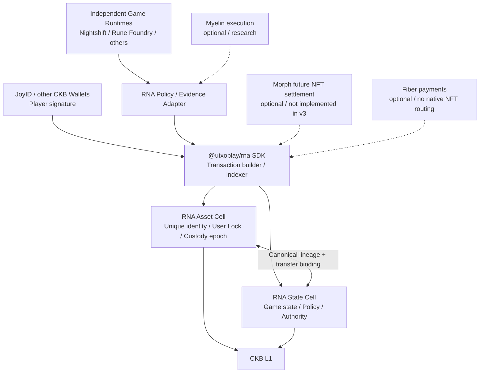
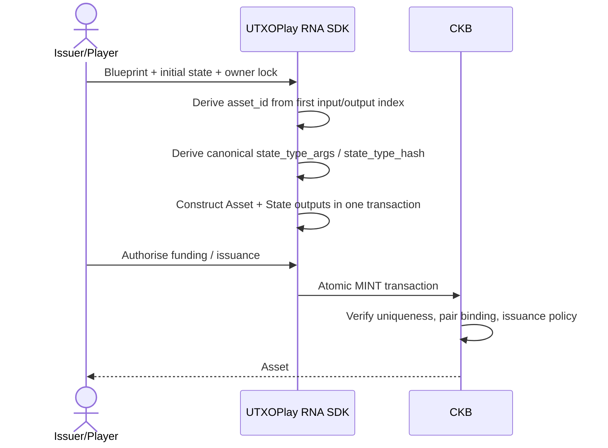
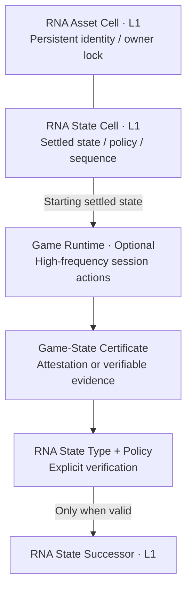
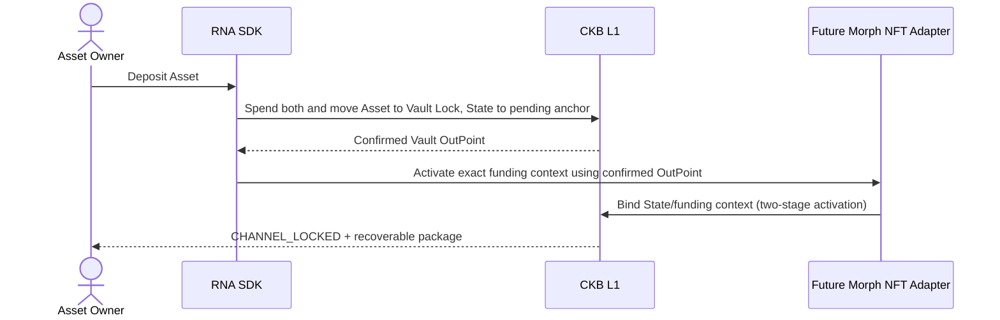

# RNA Protocol / 0 — CKB-Native Game Assets and State Protocol

**Reactive Non-Fungible Artifacts**<br>
**Subtitle:** A CKB-native protocol for game asset identity, evolving state and enforceable rights<br>
**Position:** An open protocol intended for native UTXOPlay integration and adoption by independent games<br>
**Document class:** RFC / Architecture & Security Specification<br>
**Status:** Draft 0.3 — item primitives, owner control and composition boundaries; architecture proposal awaiting implementation<br>
**Date:** 1 November 2026<br>
**Implementation direction:** Dual-Cell RNA Native; four core transition classes; restricted owner control; optional, separately verified settlement profiles<br>
**Previous draft:** [Draft 0.2](RNA_Protocol_0_Architecture_RFC_en_v0.2.md) is retained unchanged. This revision changes I-05 and the proposed data layout. All action numbers, encodings and deployment identities still require the M0 freeze.

> **The central proposition:** A game asset should possess an independent, transferable on-chain identity whilst allowing its dynamic state to evolve under verifiable rules without moving the underlying asset. Ownership authority and evolution authority may be distinct, but the ultimately enforceable State lineage and exit rights must not conflict.
>
> **RNA does not require a proprietary ownership Lock. The asset's Type Script enforces asset invariants; its Lock Script authorises spending.**

---

## 0. Executive Summary and Architectural Decision

This RFC adopts a **dual-Cell RNA Native model**, independent of Spore:

- **RNA Asset Cell:** identifies a unique game asset using a dedicated RNA Type Script, preserving an immutable definition commitment, the identity of its authoritative State lineage, and its ownership/custody epoch. Its owner-controlled write mode and admitted-terms commitment constrain game writers and binding profiles. It uses an existing wallet's CKB Lock, including JoyID-compatible Locks, and does not require a proprietary owner Lock.
- **RNA State Cell:** uses an RNA State Type Script deterministically bound to the asset to maintain evolving attributes, rule versions, game authorisations, State sequence numbers and the final settlement anchor. A dedicated State Lock supports constrained game updates, asset-linked transfers and settlement paths.
- **RNA Policy Verifier:** establishes whether an action is permissible under game-specific rules. The protocol explicitly distinguishes operator attestation, L1 rule verification and validity/dispute proofs; these must not be conflated with trustlessness.
- **UTXOPlay SDK:** handles queries, indexing, transaction construction, evidence assembly, signature co-ordination, simulation and presentation. It may build on CCC Core and the JoyID Signer, **without requiring changes to the underlying CCC or JoyID protocols**.
- **Execution / Settlement Adapters:** optionally integrate with Myelin, Morph and Fiber. The initial RNA/0 profile operates independently on L1. Morph-based NFT custody and non-cooperative exits remain future extensions; current Morph v3 must not be represented as already supporting them.

**Primitive model:** `CREATE`, `EVOLVE`, `TRANSFER` and `TERMINATE` classify the core asset/State effects. The SDK adds scoped `GRANT/REVOKE`, `CONSUME` and profile-based `SETTLE`. Game recipes compose verified effects; owner-only `PAUSE/RESUME` has a separate restricted branch. Session/custody settlement remains disabled unless its full profile is specified and supported.

**Principal choice:** The initial RNA/0 profile maintains one independent, persistent State lineage per asset rather than a shared Merkle root. A future RNA/Merkle Profile is possible, but must provide a single authority, data availability and proofs of safe exit.

This is the reference storage profile for independent game updates while retaining an ordinary holder Lock. A collectible may need only its immutable asset, and a holder-approved mutable item may use a single Cell. Custom-Lock single-Cell and shared-state designs require separate profile contracts and conformance rules; the paired genesis and wire model below continue to define the dual-Cell reference profile.

Spore plus an enforced companion State can also separate the holder's asset input from game updates. This input separation is shared with native dual-Cell RNA. Owner-control capability depends on each profile's authorised branches and validity rules. The Native choice defines its own data and lifecycle contracts.

**Non-goals:** RNA does not depend on, or promise compatibility with, Spore/DOB/Mutant; does not rebuild CKB wallet or private-key custody infrastructure; does not require every in-game item or gameplay tick to go on-chain; and is not a general fungible-token protocol, game engine, routing network or deployed L2. **A Game Session is merely an optional execution optimisation: it does not make an RNA asset or its authoritative L1 State ephemeral.**

## 1. Requirements Derived from UTXOPlay

UTXOPlay is a browser-based game store and publishing/launch platform. Game logic runs in independent game services; Myelin provides execution and replayable evidence for some games; the store handles discovery, accounts, purchases and publishing. Existing in-game items and game-purchase entitlements do not automatically constitute transferable on-chain NFTs.

RNA adoption SHOULD be **opt-in**:

| Scenario | Appropriate representation | RNA/0 responsibility |
|---|---|---|
| Ordinary levels, collisions, character positions | Game runtime / Myelin | No RNA required |
| Gold, mass-market consumables | Fungible token or game ledger | Do not require an RNA asset per unit |
| Persistent racing cars, unique weapons, rare pets | RNA Asset + State | Identity, ownership, state, upgrades, trade |
| In-game upgrades, durability and experience | Game State | Put only materially persistent state in RNA; keep high-frequency changes in the runtime |
| Player-to-player item transfer | Joint RNA L1 transaction | Atomic hand-over of asset and authorisations |
| Depositing an item into a Morph channel | Custody plus settlement evidence | Future Morph adapter; not a capability implemented by RNA/0 |
| Viewing items across games | UTXOPlay Inventory | Distinguish ownership, use, custody, pending settlement and trustworthy state |

The product objective is not another wallet. It is to let holders of existing wallets use, upgrade, sell and recover game assets.

## 2. Terminology and Security Model

- **Asset Identity:** the unique asset identity established by its RNA Asset Type Script and `asset_id`.
- **Current Custodian:** the party or mechanism controlling the actual RNA Asset Cell Lock; under custody, this may be a Morph Vault rather than the ultimate economic beneficiary.
- **Beneficial Claimant:** the party with a redeemable claim under a custody or channel arrangement, determined by the execution domain's settlement state.
- **State Lineage:** the unique succession chain of RNA State Type Script instances currently accepted for an asset.
- **State Authority:** an authorisation path permitting game-state updates within defined limits; not automatically equivalent to ownership.
- **Policy:** a verifier, identified and versioned, that defines valid state transitions.
- **State Commitment:** a hash commitment to canonically encoded game-state bytes; not a proof of data availability.
- **Game Revision:** the revision of the game state; it may advance off-chain and jump when finally settled on L1.
- **State Sequence:** a counter incremented once for each L1 RNA State successor, including transfers, delegations and settlements that do not alter game attributes.
- **Ownership Epoch:** the generation counter advanced when the RNA Asset's actual Lock/custody state changes, mirrored in the State Cell.
- **Funding Context:** the context binding a particular Morph custody arrangement to its exact Vault OutPoint. Replacing a Vault requires a new context.

### 2.1 Three Verification Profiles

| Profile | L1 acceptance condition | Trust and evidence dependencies |
|---|---|---|
| `ATTESTED` | A designated authority or quorum endorsed the exact result | The authority's account of the game result, subject to core-enforced limits |
| `SCRIPT_VERIFIED` | L1 directly checked the declared recipe, transition or bounded replay relation | Pinned rules, input authentication and required evidence availability |
| `PROOF_VERIFIED` | L1 verified the declared transition proof or an executable dispute result | The proved statement, input commitments, proof/challenge assumptions and required data |

All clients MUST display the specific Profile. A merely signed game result MUST NOT be presented as ‘fully trustless’.

Replay is an evidence/verification method, not a fourth acceptance level. If an operator or committee replays a game and L1 accepts only its signatures, the deployment uses `ATTESTED` with that authority model. Stronger acceptance requires the actual L1 transition verifier, validity proof or completed executable dispute procedure. Running signature-verification code in CKB-VM does not change what the result authority is trusted to attest. See the [verification and storage profile notes](verification-and-storage-profiles.md).

### 2.2 Item Primitives and Action Layers

RNA separates a small set of consensus transition classes from developer-facing item operations and game-specific recipes. The classes below describe transaction effects; they do not allocate additional wire opcodes.

| Core transition class | Existing action / branch vocabulary | Required effect |
|---|---|---|
| `CREATE` | `MINT` | Create exactly one new Asset identity and its canonical initial State per declared output item; validate issuance authority and limits |
| `EVOLVE` | `GAME_UPDATE` | Preserve identity and custody; validate an authorised State successor, including permitted revocable rights changes |
| `TRANSFER` | `TRANSFER`, paired `REANCHOR` | Validate the current pair and authorised custody context; preserve ordinary game attributes and retire old-context authorisations |
| `TERMINATE` | `BURN`; developer-facing `CONSUME` | Consume the current pair and end all active rights; apply the termination and carrier-refund rules |

The owner-control branch in Sections 5.3 and 6.3 is a separate, restricted protocol action family. `PAUSE` and `RESUME` change only the Asset write mode. They cannot be encoded as a State-only `EVOLVE` or an unrestricted transfer. Binding Session profiles may add `ADMIT`, `CLOSE_REQUEST`, `SESSION_FINALISE` and `CLOSE_SETTLE` under the requirements below.

| Developer operation | Consensus effect | Scope in this draft |
|---|---|---|
| `CREATE` | Atomic `MINT` of Asset and State | Core proposal |
| `EVOLVE` | `GAME_UPDATE` under a declared verifier | Core proposal |
| `TRANSFER` | Paired transfer under holder and transfer-policy authorisation | Core proposal |
| `GRANT` | Policy operation such as `GRANT_USE`; State-only only for revocable, non-encumbering permissions | Core policy interface; binding leases require paired admission |
| `REVOKE` | Policy operation terminating a grant according to its committed terms | Core policy interface; no cancellation of irrevocable third-party claims |
| `CONSUME` | `TERMINATE` under a declared use/recipe policy | Core termination boundary; cross-item recipes require a composition profile |
| `SETTLE` | Verify and accept a candidate result, then perform the specified State or custody transition | Reserved extension interface; disabled without an explicit settlement profile |

An SDK `createItem` call may build a `MINT` action. `CREATE` and `MINT` MUST NOT become ambiguously interchangeable witness encodings. M0 must assign one canonical encoding per action, distinguish policy sub-actions and reject unknown or unsupported action/profile identifiers. Draft 0.3 is a document revision, not a released wire-version allocation.

The game-operation layer combines these effects. An upgrade may be `EVOLVE`; a forge may terminate three inputs and create one output; breeding may create a child while updating the parents' breeding budgets; trade combines transfer and payment. The complete required effects MUST be verified together under the committed policy. A sequence of successful SDK calls provides no atomicity across separate transactions.

### 2.3 Item Capabilities, Definitions and Relations

Capability metadata describes operations whose enforcement can be inspected. Clients MUST identify the validating policy/profile and current conditions before presenting a capability as executable.

| Advertised capability | Enforcement source |
|---|---|
| Ownable | Actual Asset Lock and Asset Type |
| Transferable / soulbound | Transfer branch and protected transfer policy |
| Evolvable | State Type, scoped authority and transition verifier |
| Consumable | Paired termination branch and use/recipe policy |
| Lendable | Scoped grants; binding admission and release terms for an irrevocable lease |
| Craftable / breedable | Composition or issuance profile, ingredient/parent evidence and supply/budget checks |
| Equipable | Runtime state, unless persistent exclusive use requires a rights profile |
| Composable / collateralizable | Explicit attachment/custody profile with transfer, consumption and recovery rules |
| Cross-game usable | Destination domain interpretation and the rights it is authorised to exercise |

The immutable definition may contain base traits, provenance or optional DNA. Each Asset still obtains a unique genesis identity. Current XP, wear and acquired traits belong to the accepted State under the game's schema. Rendering combines the definition, accepted State and declared interpretation; inheritance recipes identify exactly which fixed or acquired parent values they use.

Logical references, permission to use another item and enforceable custody of that item are different relation profiles. A State `parent_id` or `attached_to` field is a reference unless the relevant spending scripts enforce its consequences. RNA/0 does not define a general attachment graph. A future attachment profile must check authority on both sides, permitted detachment, duplicate/cyclic relations, transfer of containers, consumption and independent recovery.

## 3. System Layers



**Mandatory separation:** RNA's `Asset` and `State` are two CKB Cells at the asset-domain layer. Morph's `Vault` and `State Header` belong to channel custody and settlement evidence. These two pairs must not be confused.

## 4. Authorities and Invariants (Normative)

MUST, MUST NOT and SHOULD below are used as normative requirements in the RFC sense.

**I-01 — Unique identity.** Each `asset_id` may have only one valid RNA Asset Type successor lineage. The RNA Asset Type MUST verify a non-replicable Type ID-style derivation at genesis (first transaction input plus Asset output index), permit exactly one matching Type Script input and one matching output on ordinary continuation, and implement explicit termination rules.

**I-02 — Atomic genesis binding.** Each newly created RNA Asset MUST be accompanied, in the same transaction, by exactly one matching authoritative RNA State lineage. Both scripts MUST cross-check the full Type Script identity of their counterpart, the references in Cell data and the genesis conditions. No party may subsequently create a second ‘authoritative’ State for an existing asset.

**I-03 — Immutable identity.** The Asset's `asset_id`, `definition_commitment`, original issuer identity and `state_type_hash` MUST remain unchanged in ordinary successors.

**I-04 — State-only update.** Every ordinary State-only update MUST supply the canonical live Asset as a dependency and verify its full Type identity, custody context, permitted execution mode and write mode. `ownership_epoch`, `custodian_lock_hash` and protected State fields remain unchanged; `state_sequence` increases by exactly one. Attribute or rights changes require the scoped Policy evidence. A State-only update cannot introduce a binding obligation onto an unencumbered Asset.

**I-05 — Coupled lifecycle, restricted control exception.** A transfer, Lock replacement, custody change, paired `REANCHOR`, binding admission or termination MUST consume the exact current Asset/State pair and validate the permitted successors or terminal outcome. The only Asset-only exception is an expressly supported control transition preserving the full custody, identity, canonical binding, Capacity and protected-terms context. It MUST have no input or output of that canonical State Type and MUST NOT change attributes or authorise a lifecycle action. The Asset Type enforces these branches independently of the chosen game verifier.

**I-06 — Atomic authority hand-over.** Transfers and custody changes MUST synchronise the State's `ownership_epoch`, actual `custodian_lock_hash`, authorisation revocation and `last_event_hash`. An off-chain authorisation issued by the previous owner MUST NOT remain valid for the new epoch.

**I-07 — Separation of powers.** Game-state update authority alone MUST NOT allow modification of the RNA Asset Lock, replacement of the Asset Type or termination of the Asset. The State Lock's game-update and asset-linked paths MUST have separate permissions.

**I-08 — Rule/version integrity.** State-consuming authorisations bind the chain, full Asset/State identities, action/profile, prior State, sequence, epoch, Policy, nonce and applicable time conditions. Ordinary game authorisations additionally bind the live Asset OutPoint. Control-only authorisations bind the Asset input, exact permitted successor, terms and action without requiring a moving State reference. Compound authorisations bind the shared operation manifest. Policy migrations require explicit authority and preserve protected holder rights.

**I-09 — Single enforceable finality.** In a supported channel execution mode, a frozen/locked L1 State MUST NOT coexist with a channel state offering an independently redeemable competing right. Non-cooperative exit MUST select one final claim under a unique authoritative state-selection rule.

**I-10 — Data availability.** A `state_commitment` without its payload and proof MUST NOT be represented as a complete, independently recoverable game-asset state. The SDK MUST label missing evidence and unverifiable states.

**I-11 — Custody is not ownership.** A change in the `Current Custodian` Lock does not invariably represent a transfer of beneficial ownership, for example when entering a Vault. A platform MUST NOT display the Vault custodian as though it were the beneficial player-owner.

**I-12 — Safe exit.** Where an execution mode promises exit without operator co-operation, its deployment MUST provide actually usable L1 verification scripts, an authoritative selection rule, complete exit evidence and the relevant deadline requirements. A runtime signature alone does not satisfy this claim.

**I-13 — State Lock and Capacity integrity.** A State-only update MUST preserve the protected State Lock identity and the State Cell's carrier Capacity, unless it uses an explicit, authorised migration or refund path. A game writer MUST NOT covertly spend State carrier Capacity as fees. Capacity refunds upon termination MUST follow a precommitted rule.

**I-14 — Persistent asset and state.** An RNA Asset MUST retain an independent, unique identity verifiable on L1. Its RNA State MUST preserve an authoritative succession lineage accepted by L1. Closing a Game Session, stopping a runtime or losing an operator MUST NOT automatically destroy the Asset or replace its settled State with a temporary database record.

**I-15 — Owner authority is not evolution authority.** The ordinary `TRANSFER` and `REANCHOR` branches of `ASSET_LINKED` MUST preserve game-attribute commitments, Policy identity and other protected fields that may not be altered in a transfer. An owner's Asset Lock signature MUST NOT, by itself, be interpreted as valid `GAME_UPDATE` evidence. An upgrade combined with a transfer MUST use an explicit compound action and independently pass Game Policy verification.

**I-16 — Game Authority is not Asset spending authority.** A valid game-operator signature or execution proof MUST NOT change the Asset Lock, burn the Asset or create a second redeemable claim without valid Asset Lock authorisation and Asset Type verification. Permission for a State-only update does not entail permission to spend the Asset.

**I-17 — Sessions are only an optional execution layer.** A `SESSION` state, operator attestation, runtime checkpoint or Myelin finality MUST NOT, by itself, replace RNA's canonical L1 State. Every L1 `SESSION_SETTLE` MUST explicitly validate the prior settled state, Policy, game-event evidence and authoritative state-selection rules. Where credible settlement and exit mechanisms have not been deployed, Session Evidence is candidate-state material only.

**I-18 — Do not confuse evidence with recoverability.** A game-operator signature can establish that an operator endorsed a transition, but not that the underlying events were independently authentic. A `state_commitment` commits to a payload but does not make it available. If the full payload, rules or necessary evidence are missing, clients MUST explicitly identify the state as not independently verifiable or recoverable.

**I-19 — Protected holder rights.** An ordinary game update MUST NOT expand the verifier's authority over transferability, custody, termination, delegation ceilings or owner control. Any restrictive issuance policy and migration consent rule must be authenticated through the immutable definition and enforced by the Types. A mutable Policy pointer cannot bypass those constraints.

**I-20 — Owner-control preservation.** `PAUSE/RESUME` preserves every Asset field except the authorised write-mode change. A binding-profile close request additionally preserves its admitted terms. No ordinary State path can reset a closing receipt, renew the Asset-based timeout or reopen writing against a paused/closing mode.

**I-21 — Admitted obligations.** Irrevocable rights, mandatory Session settlement and third-party economic claims require a supported paired admission path. Their release or fallback MUST preserve all admitted beneficiaries' claims. Revocation and owner control cannot erase them.

**I-22 — Atomic composition.** Every affected Type group MUST verify its actual inputs/outputs, its unique entry in the authenticated operation manifest, and the required common recipe/issuance conditions. Required on-chain effects MUST commit together. Ingredient reuse, unlisted outputs and inconsistent manifests MUST be rejected.

**I-23 — Terminal identity.** Termination consumes the current Asset and resolves its canonical State and all admitted obligations. An optional residual receipt is terminal and cannot support active use, further evolution, transfer or redemption of that identity. `SESSION_FINALISE` settles a Session result while retaining the asset; it is a distinct branch from item termination.

## 5. RNA Native Wire Model (Draft Molecule Schema)

**Caution:** The `.mol` below is a design-stage schema sketch. It has not been compiled with `moleculec` or checked for on-chain compatibility. The final release must freeze byte order, hashing domains, version numbers, rules for appending table fields, output-index treatment and Script-identity encoding through reproducible test vectors.

```molecule
array Byte32 [byte; 32];
array Uint16 [byte; 2];
array Uint64 [byte; 8];
array OutPoint36 [byte; 36];
vector Bytes <byte>;

// Stored in an RNA Asset Cell's data field.
struct RnaAssetDataV0 {
    version: Uint16,
    definition_commitment: Byte32,
    state_type_hash: Byte32,
    ownership_epoch: Uint64,
    flags: Uint16,
    control_mode: byte,
    control_terms_commitment: Byte32,
}

// Stored in the unique RNA State Cell for this asset.
struct RnaStateDataV0 {
    version: Uint16,
    asset_type_hash: Byte32,
    domain_id: Byte32,
    state_sequence: Uint64,
    game_revision: Uint64,
    ownership_epoch: Uint64,
    custodian_lock_hash: Byte32,
    state_schema_hash: Byte32,
    state_commitment: Byte32,
    policy_hash: Byte32,
    authority_commitment: Byte32,
    carrier_refund_lock_hash: Byte32,
    execution_mode: byte,
    funding_context_commitment: Byte32,
    last_event_hash: Byte32,
    control_terms_commitment: Byte32,
    closing_status: byte,
    finalised_control_outpoint: OutPoint36,
}

// Canonical action metadata; proof bytes are carried in a defined witness slot.
table RnaActionV0 {
    action_version: Uint16,
    action_kind: byte,
    profile_id: Byte32,
    operation_commitment: Byte32,
    asset_type_hash: Byte32,
    domain_id: Byte32,
    prior_state_hash: Byte32,
    next_state_hash: Byte32,
    policy_hash: Byte32,
    authorisation_digest: Byte32,
    evidence_commitment: Byte32,
    evidence: Bytes,
}
```

Draft 0.3 adds owner-control, admitted-terms and closing-receipt fields. The v0.2 layout and its occupancy estimates are historical baselines, not byte-compatible encodings of this revision. `OutPoint36` denotes the canonical packed CKB OutPoint; `closing_status` distinguishes absent and finalised receipts, with a zero OutPoint required when absent. Unknown flags/status values MUST be rejected. A paired close clears the admitted context only after its obligations are discharged.

The fixed-width sketch sums to 109 bytes of Asset data and 416 bytes of State data. Occupied Capacity also includes the actual Locks, Types and Capacity fields; these data lengths are not deployment measurements. A control-only action uses canonical absent/zero State hashes and binds its Asset input and successor through the versioned control body and operation commitment. M0 must freeze that body; it cannot require the current State as an input or dependency.

`operation_commitment` is carried in action witness data. Output State/receipt hashes must be computable before that manifest is signed. Output event receipts MUST exclude the manifest commitment and any signature/proof computed over it, preventing circular hashes. M0 must freeze this dependency order, canonical receipt payloads, manifest encoding and action/profile domains. The added fields remain an uncompiled schema sketch.

### 5.1 Asset Identity

`asset_id = CKB_TYPE_ID_LIKE(tx.inputs[0], asset_output_index)` constructs **RNA's own Asset Type Script args**. This does not put the built-in TYPE_ID script alongside the RNA Type Script on one Cell: a CKB Cell has only one Type Script. The RNA Asset Type MUST itself validate the uniqueness condition.

`asset_type_hash = script_hash(full RNA Asset Type Script)`, whose `args` contain the derived `asset_id`.

`state_type_args = H("RNA_STATE_LINEAGE_V0" || chain_id || asset_type_hash || domain_id)`.

`state_type_hash = script_hash(full RNA State Type Script)`.

Asset Data stores `state_type_hash`; State Data stores `asset_type_hash`. The two Types refer to each other's **Script identities**, not to each other's Data hashes, so their definitions do not introduce circular hashing. In RNA/0, `domain_id` is fixed at issuance to the primary game domain. Cross-game secondary state must not become a competing authoritative RNA Core State lineage.

### 5.2 State, Versions and Custody

Draft `execution_mode` enumeration:

- `0 = L1_ACTIVE`: independent State-only evolution is permitted;
- `1 = DEPOSIT_PENDING`: channel entry has begun, but the Vault OutPoint is not yet activated;
- `2 = CHANNEL_LOCKED`: L1 is frozen, and the currently redeemable state is determined by the bound settlement context;
- `3 = SETTLING`: a non-cooperative exit or dispute is under way;
- `4 = FINAL`: terminal; no further evolution permitted.

`L1_ACTIVE` permits ordinary writes only when the Asset control mode and supported profile allow them. Each paired transition MUST enforce the permitted execution/control combination. A channel-bound or pending-deposit item cannot retain an unencumbered `OPEN/PAUSED` control context.

`custodian_lock_hash` mirrors the actual Asset Cell Lock. In `CHANNEL_LOCKED` mode it identifies the Vault, not the player's beneficial claim. An off-chain Beneficial Claimant MUST be independently established by channel settlement state.

`state_sequence` counts **L1 successors**, increasing by exactly one for each valid State Cell replacement. `game_revision` records game changes and may skip ahead from the old checkpoint upon final Morph/Myelin settlement, but only with a valid proof. A permitted revision jump is not a licence to omit Game Policy verification.

`definition_commitment`, `policy_hash` and `state_schema_hash` establish hash identities only. They do not guarantee that external data remains available. If UTXOPlay promises long-term rendering, it SHOULD use a defined preservation mechanism or on-chain storage.

`carrier_refund_lock_hash` precommits the legitimate recipient of the State Cell's occupied Capacity upon termination or exit. An ordinary State-only update MUST preserve the State Cell's Capacity exactly, paying transaction fees from other inputs. Asset transfers involving a change in refund recipient MUST be governed by the asset-linked rules.

### 5.3 Owner-Control Modes and Admitted Terms

`control_mode` is independent of the State's `execution_mode`:

| Asset control mode | Ordinary game writes | Permitted control transition |
|---|---|---|
| `OPEN` | Allowed in the supported L1 execution mode | Owner `PAUSE`; paired lifecycle actions; profile admission |
| `PAUSED` | Rejected | Owner `RESUME`; permitted paired lifecycle actions |
| `BOUND` | Only as admitted by the binding profile | Profile-authorised close request; declared paired settlement |
| `CLOSING` | Rejected | At most one profile final State; paired final/fallback settlement |

These are symbolic values pending the M0 encoding freeze. Unknown modes and unsupported profiles MUST be rejected. Core L1 `PAUSE/RESUME` uses a zero `control_terms_commitment`. `BOUND/CLOSING` requires a nonzero commitment mirrored in State and an explicitly supported profile. A custody adapter MUST prohibit generic L1 control actions that could bypass its own settlement protocol.

An admitted-terms payload identifies its profile and version, a unique admission/session ID, starting State, scope, result verifier, beneficiaries and obligations, permitted changes, any earliest-close condition, closing delay and independently usable fallback. Its canonical encoding and verification bounds must be frozen by that profile. Admission consumes both Cells, authenticates the holder and every required counterparty, verifies the terms, and advances State sequence. Ordinary State-only writes preserve these terms and cannot introduce an irrevocable lease or pending third-party claim onto an `OPEN` Asset.

The starting anchor references the prior State OutPoint and its accepted game-state commitment, with the known admission-successor sequence. It MUST NOT hash a new State output that itself contains this terms commitment. Admission IDs and result certificates use this acyclic context. The profile must specify whether admission changes attributes or only records rights and terms.

`PAUSE/RESUME` preserves the Asset Type, actual Lock, definition, State Type binding, ownership epoch, Capacity, flags and every other protected field. `CLOSE_REQUEST` additionally preserves all admitted terms. The action MUST contain no input or output of that Asset's canonical State Type. No control-only branch can transfer custody, edit attributes, terminate the item or reset accepted rights.

All ordinary game authorisations bind the exact live Asset OutPoint. Following a pause/resume, old signatures cannot be redirected to the new dependency. State-consuming actions bind prior State and sequence; control-only signatures instead bind the chain, Asset input OutPoint, action, complete permitted successor and terms. They require no moving State input or State dependency.

Asset and State outputs cannot commit their own newly created OutPoints into data contributing to the same transaction hash. Ordinary update witnesses reference an already-existing Asset. A final State may record an already-existing closing Asset OutPoint. Admission identifiers must use a non-circular derivation, such as prior inputs plus a domain-separated nonce and terms.

## 6. Lock and Type Script Responsibilities

### 6.1 RNA Asset Cell

```text
RNA Asset Cell
├── Lock: standard wallet-owned CKB Lock
│   └── JoyID / another supported CKB Signer
├── Type: RNA Asset Type Script
│   └── args = unique RNA asset_id
└── Data: definition + State lineage + epoch + control mode/terms
```

- The wallet Lock verifies **who authorises spending this asset**.
- The RNA Asset Type verifies **how the protocol permits this asset to change**.
- The RNA Asset Type need not know the algorithm for upgrading a racing car. It must recognise action kinds, State coupling, enforceable lifecycle rules and the authorisation boundary.
- The owner may not replace the wallet Lock without the matching RNA State transition. A game-server signature alone may not spend the Asset Cell.

### 6.2 RNA State Cell

```text
RNA State Cell
├── Lock: RNA State Lock V0
│   ├── GAME_UPDATE: limited game-policy authority
│   ├── ASSET_LINKED: matching Asset Input + valid Asset Lock
│   ├── CHANNEL_SETTLEMENT: verified settlement proof
│   └── RECOVERY: explicitly precommitted escape policy
├── Type: RNA State Type Script
│   └── args = deterministic state_type_args
└── Data: state commitment + sequence + policy + authorisation
```

- `GAME_UPDATE` MUST NOT alter the Asset Lock, covertly replace the State Lock, extract State carrier Capacity or obtain spending authority over the Asset Cell.
- `ASSET_LINKED` SHOULD NOT require the operator to remain online indefinitely to co-sign. It MUST depend upon the matching RNA Asset Input and Asset Type checks in the same transaction; CKB must independently validate the Asset Input's Lock.
- `CHANNEL_SETTLEMENT` MUST verify the channel's authoritative settlement evidence and the applicable RNA Policy. The mere existence of a signed Header cannot establish a valid game upgrade.
- `RECOVERY` MUST NOT covertly bypass a game's precommitted non-transferability or termination rules. Its powers, delays and exit conditions SHOULD be stated at issuance.

### 6.3 Owner Control and Writer Racing

The State Lock admits a permitted paired transfer through `ASSET_LINKED` even when the game operator is offline. The following control protocol addresses contention for the State input; protected transfer and termination policies remain enforced.

Every `GAME_UPDATE` MUST supply the canonical live Asset as a `cell_dep`. The State scripts verify its full Type identity, custody snapshot, epoch, execution context and write mode. Reading an Asset does not spend it; CKB dependency resolution requires it to be live. See [RFC 0022](https://github.com/nervosnetwork/rfcs/blob/master/rfcs/0022-transaction-structure/0022-transaction-structure.md#code-locating).

For an unencumbered L1 item, the owner spends only the `OPEN` Asset into a `PAUSED` successor. The transaction has no State dependency or State input. Further State writes cannot stale its Asset input, because the game lacks the holder's Asset-spending authority. Updates ordered before the pause may remain accepted. Updates ordered after it either reference a dead Asset or fail the paused-mode check. Once the owner has ordinary L1 inclusion and chosen confirmations, it can resolve the stable State and perform the permitted paired action. Resume produces a fresh Asset anchor and requires fresh ordinary-update authorisations.

This is a progress argument against State-writer contention, conditional on ordinary transaction inclusion, available evidence and the chosen reorg policy. It does not establish a wall-clock inclusion deadline. The accompanying abstract model checks the proposed transitions; deployed script/node verification is still required.

#### 6.3.1 Binding Session Close (Extension Profile Proposal)

A binding Session uses paired `ADMIT` to record its terms and set the Asset to `BOUND`. Core L1 deployments without this profile MUST reject that admission. A binding lease's minimum term must be enforced before a close request can proceed; State updates cannot renew the Asset's time anchor.

An earliest-close delay is checked using canonical relative `since` on the consumed BOUND Asset input. The later fallback delay is checked on the new CLOSING Asset input. Neither clock is based on a repeatedly replaced State Cell.

The holder's Asset-only `CLOSE_REQUEST` changes `BOUND` to `CLOSING`, preserving custody and terms. Ordinary State writes stop. The profile may permit **one** `SESSION_FINALISE` State successor for this closing Asset OutPoint. State records that context and a finalised status; all subsequent State-only actions must preserve the receipt and reject further finalisation. No Asset-only transition may replace a `CLOSING` Asset with another closing context.

Final evidence binds the admitted Session, starting commitment, result and policy; it may have been retained before the close. Its applicability to the frozen State must be verified. This evidence has a different action domain from an ordinary Asset-OutPoint-bound game update. The resulting receipt binds the current, already-existing closing Asset OutPoint.

The paired `CLOSE_SETTLE` path either preserves the accepted final result or applies the admitted fallback. For an unfinalised close, the Asset input MUST carry canonical relative `since` with at least the admitted closing delay. Consensus checks maturity from that Asset's commitment block. State updates therefore cannot restart the timer. See [RFC 0017](https://github.com/nervosnetwork/rfcs/blob/master/rfcs/0017-tx-valid-since/0017-tx-valid-since.md).

If finalisation wins the race with the owner's settlement, it can stale the selected State once. The owner then rebuilds against the final State. If the paired settlement wins first, the closing Asset is spent and late finalisation has a dead dependency. No upper deadline on finalisation is needed for this bound. A profile using this argument MUST prohibit all other State-only writes while `CLOSING`.

For the illustrative wear-only profile, admission at durability 63 permits at most five wear. Ordinary and final results preserve confirmed effects and stay within the admitted range. After six blocks, the fallback settles durability 58 and awards no provisional XP. This conservatively charges the admitted maximum loss. These numbers are example terms, not RNA-wide constants. Wagers, multi-owner crafting, collateral and rewards owed to others require their own allocation, evidence and recovery rules; the wear example does not supply them.

### 6.4 Action Branches and Authorisation

An ordinary holder able to sign for an Asset Cell is not thereby entitled to modify level, wins, durability or other fields governed by a Game Policy. Conversely, an operator authorised to use the State Cell's `GAME_UPDATE` path is not thereby authorised to transfer the Asset Cell.

| Transaction branch | Asset input | State input | Authority and dependencies | Attribute effect |
|---|---|---|---|---|
| `MINT` / SDK `CREATE` | None for new item | None for new item | Issuance verifier and any required recipe/parent authority | Initial State |
| `GAME_UPDATE` / SDK `EVOLVE` | None | Current State | Live writable Asset dependency and scoped Policy evidence | Verified State changes |
| `GRANT_USE / REVOKE` policy action | None only with an already authorised State path; otherwise paired | Current State | Live Asset or paired Asset Lock; scoped grantor/revoker authority and release conditions | Scoped rights only |
| `TRANSFER / REANCHOR` | Current Asset | Current State | Asset Lock, reciprocal Type checks and transfer policy | Preserve game attributes |
| `PAUSE / RESUME` | Current Asset | None | Asset Lock and strict control branch; no canonical State dependency | No State changes |
| `BURN` / SDK `CONSUME` | Current Asset | Current State | Asset Lock, terminal policy and discharged obligations | End active identity |
| Compound operation | Each input required by its effects | Each required current State | Every affected authority and the same verified operation manifest | Only declared, jointly verified effects |
| `ADMIT` (supported binding profile) | Current Asset | Current State | Holder/counterparty admission and terms verifier | Record binding context |
| `CLOSE_REQUEST` (supported profile) | BOUND Asset | None | Asset Lock and preserved terms; enforced earliest-close condition if present | No State changes |
| `SESSION_FINALISE` (supported profile) | None | Current State | Live CLOSING Asset, valid Session evidence, unused close context | One accepted final State |
| `CLOSE_SETTLE` (supported profile) | Closing Asset | Current State | Asset Lock, accepted final result or matured admitted fallback | Declared settlement; preserve resulting rights |
| Other `SESSION_SETTLE / CHANNEL_SETTLEMENT` | Profile-dependent | Profile-dependent | Explicit supported verifier and authoritative selection | Declared result only |

Normative requirement: `ASSET_LINKED` MUST bind the exact current Asset's full Type Script identity, valid inputs, State successor and required output commitments. The ordinary `TRANSFER` path MUST enforce `next.state_commitment == previous.state_commitment`, preserve the Policy, advance the ownership epoch, update the Lock snapshot and revoke the required old authorisations. A player's signature and the presence of an Asset Input MUST NOT weaken game-state validity checks.

CKB independently verifies the Lock for the Asset Input. The State Lock need not reimplement JoyID cryptography, but MUST verify the transaction structure and paired Asset; the Asset Type and State Type must enforce the reciprocal security constraints. The exact Witness format and index-matching rules remain to be frozen at M0.

### 6.5 Game Policy Verification Contract

The verifier's code may be pinned while still evaluating a complete state machine. Schema parsing and range checks alone supply no relation between a prior accepted State and an earned result. The selected policy must state the relation it actually enforces, including any attested game-event source.

The existing `policy_hash` may commit to a canonical descriptor covering verifier code/version/configuration, State/action schemas, accepted input authentication and ordering, time/randomness, execution program/context, evidence encoding, L1 acceptance/settlement rules, administrator privileges and migration authority. This descriptor remains a proposal whose ABI, canonical encoding and bounds must be frozen by the supported profile. It introduces no additional fixed-width State fields in this clarification.

The State Type MUST authenticate the descriptor and force the selected acceptance procedure to execute alongside all kernel checks. Providing a code Cell or metadata hash is insufficient. VM invocation or an execution hand-off MUST preserve every required identity, custody, capacity, control and protected-rights check. Game-specific verifiers cannot replace those checks or accept an arbitrary policy migration.

An unmodified or dishonest game client may display a fabricated reward. A canonical RNA update is accepted only when the actual L1 branch's conditions are met. Under `ATTESTED`, a declared authority may endorse that reward; direct verification/proof profiles must enforce their declared transition relation. The [companion note](verification-and-storage-profiles.md) separates input integrity, rule execution, session finality and settlement selection.

## 7. RNA/0 Core Lifecycle and Transaction Flows

### 7.1 `CREATE` / `MINT` — Atomic Dual-Cell Genesis



**Required checks:** The Asset Type genesis group has exactly one output and no matching input; the State Type genesis group likewise has exactly one output and no matching input; both outputs cross-reference the full Script hashes; State genesis cannot be forged during a transfer of an existing Asset. If issuance limits exist, an independent, non-duplicable Issuance Authority or appropriate counter/proof MUST enforce them. A static Blueprint declaration alone is insufficient.

**Important:** Minting an RNA Asset does not automatically mean UTXOPlay provides marketplace support for every NFT on CKB. RNA needs its own indexer and parser. Nor must every game item become RNA.

### 7.2 `EVOLVE` — State-Only Update

```text
Input:   RNA State(seq=17, game_rev=30, epoch=4)
CellDep: current canonical Asset in a writable mode
Witness: GAME_UPDATE + policy evidence + Asset-OutPoint-bound digest
Output:  RNA State(seq=18, game_rev=31, epoch=4)

Asset Cell: NOT SPENT
```

Scripts MUST preserve the `asset_type_hash`, `domain_id`, `ownership_epoch`, `custodian_lock_hash` and `state_type_hash` identity. The Policy MUST determine permissible changes to `state_commitment`, `authority_commitment` and `game_revision`. An operator-signature Profile must be clearly distinguished from a proof establishing the truth of a game event.

### 7.3 `TRANSFER` — Atomic Hand-over of Asset and State Authority

```text
Inputs:
  RNA Asset #42   Lock = Alice    epoch = 4
  RNA State #42   owner_lock_hash = H(Alice), epoch = 4, seq = 18

Outputs:
  RNA Asset #42   Lock = Bob      epoch = 5
  RNA State #42   owner_lock_hash = H(Bob),  epoch = 5, seq = 19

Authorisation:
  Alice's normal wallet lock succeeds;
  State Lock ASSET_LINKED path succeeds;
  RNA Asset/State Type Scripts verify one another.
```

- Game-specific transfer restrictions MUST be verified where applicable, for example a precommitted Soulbound flag.
- Game attributes MUST remain unchanged in an ordinary transfer. A transaction that also upgrades the item must use an explicit, distinct compound action with complete corresponding Policy Evidence.
- Authorisations from the old `ownership_epoch` MUST become invalid. The use/evolution rights obtained by the recipient depend upon the policy expressly committed at issuance; it must not be presumed that all game permissions automatically transfer.
- A transfer back to the same Lock hash may use paired `REANCHOR`, with a refreshed epoch and protected attributes. This is distinct from Asset-only `PAUSE/RESUME`, which preserves epoch.
- An ordinary transfer may use an `OPEN` or `PAUSED` pair. `BOUND/CLOSING` requires the admitted profile's release, settlement or explicitly supported lease-preserving handover; the ordinary path cannot clear its terms.

### 7.4 `GRANT / REVOKE` — Scoped Policy Operations

The SDK maps `GRANT` to a policy operation such as `GRANT_USE`. The grant records its identity, subject, game domain, permitted actions, delegation ceiling, duration/usage budget, revocation conditions and behaviour on transfer/termination. The verifier checks the grantor's existing authority; possession of a State input or an arbitrary signature grants no additional privilege. Subdelegation may only narrow the admitted scope.

A State-only rights operation uses an authority already accepted by the State Lock and Policy. If a new grant requires the holder's ordinary wallet Lock to be executed, it uses an explicit paired rights/context action with both Cells and the required Policy checks. Merely reading that wallet Lock through an Asset dependency supplies no holder signature. The paired action preserves game attributes and applies the declared epoch/nonce rules.

`REVOKE` authenticates the revoker, references the current grant generation and follows its release terms. Revocable service rights can use State-only `EVOLVE`. An irrevocable match permission, rental claim, collateral or mandatory pending loss requires paired admission and a supported binding profile. A game's ordinary rights-update path cannot impose that encumbrance on an `OPEN` Asset. Operator-only `GRANT` cannot make an item permanently non-transferable.

### 7.5 `TERMINATE` / `CONSUME` — Resolve the Current Identity

Core termination consumes the current Asset/State pair, validates holder and termination authority, discharges admitted obligations and directs carrier refunds under the committed rules. SDK `CONSUME` expresses the game use; `BURN` names the terminal lifecycle branch. A deployment MUST specify whether it produces no companion State output or retains a permanently terminal receipt. Every implementation of a variant must reject later active successors and revival of the same identity.

An item-terminal `FINALISE` label, if exposed, denotes this fully resolved terminal outcome. `SESSION_FINALISE` instead accepts one result for an active item and does not consume its identity. Parsers and authorisation domains MUST distinguish them.

Cross-asset forge/merge recipes require the composition profile in Section 7.7. Each ingredient must terminate and each result must have valid issuance authority; neither burning inputs alone nor generating a fresh output ID authorises an arbitrary result.

### 7.6 Persistent Items and Optional Session Settlement

**An RNA/0 asset is not an ephemeral NFT.** Its Asset Cell and State Cell together constitute a long-lived game asset that may be held and transferred and whose transitions are constrained by L1. A Session contains ongoing actions and candidate changes not yet settled; it cannot unconditionally override a settled State.

For example:

| Information | Example | Authoritative location |
|---|---|---|
| Unique asset identity | `Sword #42` | RNA Asset Type (L1) |
| Most recently confirmed level | `Level 12` | RNA State (L1) |
| Most recently confirmed enhancement | `+5` | RNA State (L1) |
| Temporary attack bonus during this battle | `+20%` | Game Session |
| Experience pending settlement | `+300 XP` | Session Evidence (candidate) |



Both of the following modes are possible; a game need not adopt Sessions:

**Direct L1 Evolve (core RNA/0 path):** The game submits valid `GAME_UPDATE` authorisation and rule evidence, consumes the State Cell and creates its successor. The Asset Cell is untouched. Every update must pass full State Type/Policy verification.

**Session-assisted Evolve (optional/future Profile):** The game executes several short-lived actions and generates a verifiable record or Game-State Certificate. A suitably authorised transaction submitter later presents `SESSION_SETTLE`, enabling the L1 State Type/Policy to accept a new final state. The evidence must bind the chain, `asset_id`, `state_type_hash`, starting State commitment, Policy, ownership epoch, `session_id`, final State commitment, `game_revision`, nonce/expiry and signing authority. Until this Certificate has been properly validated and confirmed, it is **not** the new canonical L1 State.

`ATTESTED` proves only that the designated Game Authority signed the outcome; **it does not establish that the match was authentic, fair or independently replayable**. The guarantees of `SCRIPT_VERIFIED` and `PROOF_VERIFIED` must be described in terms of their actual verification predicates.

For `SESSION_SETTLE`, the Game Authority may be responsible for **endorsing the result** without itself being required to **publish every L1 State transaction**. Open submission is not permission for arbitrary users to submit fabricated upgrades: the State Type must verify trusted authorisation or genuinely valid evidence.

#### 7.6.1 An Ordinary User Attempts to Forge a Level: MUST REJECT

```text
Asset #42: Alice's JoyID Lock
State #42: Level 12, Policy P, Seq 45

Alice submits:
  Input:  State #42 (Level 12)
  Output: State #42 (Level 99)
  Proof:  only Alice's wallet signature

Expected result: REJECT
```

An ordinary Owner signature establishes authority to spend the Asset, not permission to use the State Lock's `GAME_UPDATE` branch or an exemption from Policy verification. If Alice instead attempts to use `ASSET_LINKED` to circumvent this rule, the ordinary `TRANSFER` path must also require `state_commitment` to remain unchanged.

#### 7.6.2 A Legitimate Player Transfer: Preserve Game State, Hand Over Rights

```text
Inputs:
  RNA Asset #42 → Alice, epoch=4
  RNA State #42 → Level 12, seq=45, epoch=4

Outputs:
  RNA Asset #42 → Bob, epoch=5
  RNA State #42 → Level 12, seq=46, epoch=5

Allowed: Owner-authorised transfer + valid State pairing.
Forbidden:  Level 12 → 99 without separate, verifiable Game Policy evidence.
```

An ordinary transfer may advance `state_sequence` and MUST advance `ownership_epoch`, but it must not arbitrarily alter game state. Evolution authorisations from the previous epoch are invalidated according to the precommitted rules.

#### 7.6.3 What Survives When the Player or Game Operator Goes Offline?

The Asset and its confirmed State remain verifiable and holdable on CKB. Unsettled experience, loot and match outcomes may be described as independently recoverable **only** if the user has the complete necessary evidence and there is a deployed, executable settlement path. A hash without payload, signatures and required rule material cannot support a promise of full progress recovery.

#### 7.6.4 Non-Cooperative Exit and Third-Party Rights

If a Session has generated enforceable economic claims for third parties, the player cannot unilaterally revoke those claims simply by restoring an old State. A final-state selection/dispute mechanism accepted in advance by the relevant parties and enforceable on L1 is required. RNA/0 does not claim to have deployed such a mechanism, nor does it treat Myelin's internal finality as equivalent to L1 settlement finality.

### 7.7 Composing Game Operations Across Type Groups

The following mappings specify required effects, not shipping game implementations:

| Game operation | Required effects and authorisation |
|---|---|
| Upgrade / wear | `EVOLVE` with the scoped game evidence and any required material/payment checks |
| Trade | Paired `TRANSFER` plus exactly bound payment outputs; buyer accepts a specific State or explicit predicates on it |
| Forge / merge | `TERMINATE` each declared ingredient and `CREATE` the authorised result in the same transaction |
| Breed | `CREATE` with authenticated parent identities, accepted source traits and required consent; preserve parents unless the recipe declares consumption |
| Rent | Grant scope, binding admission where promised, payment/collateral checks, loss allocation and enforceable release/close terms |
| Equip | Runtime change; persistent rights transition only when exclusive use or economic obligations require it |
| Session result | `SETTLE` through a supported profile, then the declared State/custody effects |

#### 7.7.1 Operation Manifest and Atomicity

A composition profile MUST authenticate an operation manifest identifying the chain, recipe/profile and version, action domain, complete participant set, exact ingredient and result Type identities, actual input/output indexes, prior and successor commitments, authority requirements, and payment/refund conditions. Signatures or proofs bind that manifest commitment. The action envelope carries the same commitment for every affected RNA group.

Every participating Asset and State Type MUST verify its unique manifest entry against the actual transaction, execute its own permitted branch and invoke the required composition checks. The shared verifier MUST enforce ingredient eligibility, output count and issuance authority, quantities by asset domain, protected rights, and complete accounting of consumed inputs and newly created outputs. An ingredient cannot independently authorise two recipe results, and a result cannot omit an ingredient's required consent or companion State. Duplicate entries, inconsistent manifests, index substitution and unlisted effects MUST be rejected. Manifest and proof bounds belong to the profile's frozen validation rules.

All required on-chain effects must occur in one CKB transaction. Invalid output issuance or a failing ingredient group rejects the entire operation. Separate SDK calls in different transactions must not be advertised as an atomic forge. A multi-step protocol needs an explicit recoverable escrow and must disclose its intermediate claims.

For example, merging Cats A and B into Cat C requires both current Asset/State pairs, the consent and recipe evidence for their termination, and the authorised genesis pair for C. Supply rules must enforce the prescribed number of results; distinct new IDs alone do not prevent over-issuance. A rollback/failure scenario must leave both input pairs unspent.

#### 7.7.2 Breeding Budgets and Parent Continuity

A breeding profile identifies each parent, the exact accepted definition/State traits used, any required holder or delegated consent, and the issuance rule for the child. Parents may remain active. If breeding uses a limited count, cooldown or one-use permission, the same atomic operation MUST consume and advance the authoritative budget state or another non-reusable right. Parent Cells supplied only as read dependencies cannot enforce a decreasing breeding budget. Concurrent attempts must not both consume the same allowance.

#### 7.7.3 Scoped Rights and Revocation

A grant identifies the item, domain, grant ID, subject, permitted actions, duration/usage limits, delegation ceiling, revocation rule and treatment on transfer or termination. The verifier must authenticate the grantor's authority and prevent privilege expansion by subdelegation. A revocation references the grant and its generation, increments the relevant nonce/sequence and follows its release terms. Consensus-time or signed-lease expiry must have a declared enforceable timing predicate; a metadata timestamp alone cannot release an on-chain claim.

CKB `since` enforces a not-before condition on an input. A profile using an expiry MUST specify its actual clock evidence and release transaction; it cannot assume a general not-after check merely from a signed timestamp. The close proposal uses the consumed Asset as a minimum-delay anchor.

Revocable service permission can use `EVOLVE` without spending the Asset. An irrevocable rental, reserved collateral or mandatory loss settlement requires paired admission and the binding profile. `REVOKE`, `PAUSE` and an ordinary sale MUST NOT erase those obligations. The optional close protocol in Section 6.3.1 applies only where its complete terms and verifier are supported.

## 8. Consistency, Concurrency and Cross-Cell Constraints

**8.1 Reciprocal lifecycle and control checks.** The Asset Type locates the exact canonical State for every paired lifecycle action. Its control-only exception instead verifies the complete protected Asset successor and the absence of canonical State inputs/outputs. The State Type rejects State-only paths that disguise a lifecycle/control spend of the same Asset in the same transaction.

**8.2 Authenticate the supplied live Asset.** State-only actions supply the Asset through `cell_deps`; scripts verify its full Type, data and context against the State snapshot. CKB resolves its liveness. Reading that dependency does not execute its Lock or establish permission to spend it. Paired actions synchronise custody and epoch; control-only actions preserve them. This needs no network-wide lookup by a script.

**8.3 UTXO concurrency.** State Cells belonging to distinct assets may evolve in parallel. Updates to the same asset must still be serialised because they consume the same current State UTXO. Dual Cells do not provide unlimited same-asset concurrency.

**8.4 Writer Racing.** The reference mechanism is Asset-only pause for an unencumbered L1 item and, under a supported binding profile, a fixed closing Asset anchor with one final State update. Required ordering cases and limitations are in Section 6.3. A certificate submitter is subject to the same dependency/mode checks as the operator. No per-N-actions wallet top-up is required by the core design.

**8.5 Composition domains.** Strict action/profile parsing separates ordinary evolution, control, transfer, termination and settlement. Every affected group verifies its manifest entry and common operation commitment. Unsupported profile IDs or proof shapes are rejected; an SDK operation name cannot enable a weaker consensus branch.

## 9. Morph-Aware Settlement Profile (Future Extension; Not Implemented by RNA/0)

### 9.1 Principles

[Morph](https://talk.nervos.org/t/morph-channel-explained-separating-value-state-evidence-and-fee-responsibility-on-ckb/10378) separates its Vault (actual asset custody), State Header (evidence for the latest enforceable channel state), and Sponsor (fee funding). Its current v3 research implementation supports bounded CKB and CKB-plus-one-xUDT settlement on a local devnet, as well as Factory Merkle rights. **It does not yet provide an RNA NFT-aware Vault or Settlement Descriptor.**

**The RNA State Cell is not the Morph State Cell.** The former describes a game asset's L1 state; the latter supports selection of channel claims and settlement evidence.

### 9.2 Channel Entry: `L1_ACTIVE → DEPOSIT_PENDING → CHANNEL_LOCKED`



A newly created output's OutPoint consists of its transaction hash and output index. A deposit transaction cannot assume its own final Vault OutPoint and commit that value into data contributing to its transaction hash without creating a circular dependency. A staged process compatible with Morph's existing two-stage Vault activation should bind the confirmed, actually existing Vault OutPoint. Pending, unactivated deposits must have an audited timeout cancellation/recovery path; they must not become permanently frozen.

The entry transaction must also bind an adapter-specific Asset control context and terms. Generic L1 `PAUSE/RESUME` and the illustrative wear-only Session close cannot release channel custody. The adapter defines the permitted control/execution combinations and retains its own state-selection and cancellation rules.

In `CHANNEL_LOCKED` mode, the L1 State Cell MUST prohibit independent `GAME_UPDATE`. Morph state may commit to `beneficial_claimant`, `game_state_commitment`, `game_revision` and `policy_evidence_commitment`. These values must bind the `asset_id`, Funding Context, State Number and channel participants.

### 9.3 State Transitions Within a Channel

```text
Vault: Asset #42 (remains locked)
RNA L1 State anchor: game_rev = 10

Morph signed state #100: claimant=Alice; game_rev=10
Morph signed state #101: claimant=Alice; game_rev=11
Morph signed state #102: claimant=Bob;   game_rev=11
Morph signed state #103: claimant=Bob;   game_rev=12
```

Morph establishes **which channel state may ultimately settle**. RNA Policy establishes **whether the game state evolved legally**. Neither verification discharges the other's responsibility. Where operator signatures are used, the guarantee is limited to an outcome endorsed by that operator, not independently replayed validity.

### 9.4 Exit: Cooperative and Non-Cooperative

- **Cooperative Close:** With participant authorisation, atomically return the RNA Asset and new RNA State under a bounded, enforceable settlement descriptor. This is not a capability to be presumed available in Morph v3.
- **Disputed Close:** Execute valid State Publication/Supersession/Challenge before settling the RNA Item and State once the latest enforceable state has been selected. A watchtower must hold the latest state and all necessary evidence.
- **No Double Exit:** An old L1 State must not coexist with a final Morph claim that can redeem the same item independently. Once the asset has exited, the old Funding Context may not be used to claim it again.
- **Exact Materialisation:** The full resulting RNA Asset Type, Lock, Data and State evidence must match the signed settlement rules exactly. Comparing only an item name, Type label or unverified hash is insufficient.
- **Data Availability:** A legitimate holder must be able to reconstruct the complete evidence needed for exit while another party is offline. Otherwise, non-cooperative safe exit must not be promised.

### 9.5 Capabilities Required in a Future Morph v4

1. A bounded Multi-Cell / Typed Vault Set, or an auditable RNA-specific Vault Profile.
2. A `NonFungibleAssetDescriptor` covering exact asset identity, State lineage, claimant, final Policy and output material.
3. An RNA state-settlement verifier establishing legal game-revision evolution, or explicitly declaring the applicable trusted verification Profile.
4. A unique claim to each NFT identity and exact materialisation.
5. Factory NFT Rights, if adopted; an RNA asset must not be represented as a fungible `u128` amount.
6. Tests for non-cooperative close, State Supersession, reorganisations and independent watchtower recovery.

The current Factory's quantity-based rights tree must not simply be relabelled as NFT support. Sparse Merkle Proof machinery may be reused, but identity uniqueness, authority hand-over and exit proofs cannot be omitted.

## 10. Myelin Adapter (Execution Interface, Not a Completed On-Chain Court)

Myelin orders, executes and preserves Cell-state transitions and their evidence during finite execution sessions. Its research implementation offers CKB-VM verification, checkpoints and evidence stages, but a complete public-network data-availability, court and settlement path has not been deployed as a trustless L1 mechanism.

The RNA/Myelin Adapter SHOULD expose:

```text
rna.asset_id
rna.state_type_hash
rna.domain_id
rna.input_game_revision
rna.output_game_revision
rna.action_digest
rna.policy_hash
rna.execution_receipt_commitment
rna.checkpoint_root
rna.exit_proof_reference
```

`Myelin-finalised` MUST NOT be treated as synonymous with `CKB-enforceable`. A deployment permitting an RNA Asset to exit Myelin must implement asset custody, valid state selection, proofs, data availability and an exit package available to the user.

The application authenticates command identities and payloads and binds them to permitted economic actions. Session execution and replay produce evidence under that declared program; the chosen finality module and RNA's L1 acceptance predicate have separate responsibilities. An RNA adapter must identify the exact proof, verdict or authority/quorum accepted on L1 and the prior custody/State context it consumes. Current session-safety integration contracts and local recovery admission do not authorise arbitrary CKB withdrawals. See [Myelin session safety](https://github.com/Myelin-Labs/Myelin/blob/main/docs/architecture/session-safety.md).

## 11. Fiber Adapter (Payment Interoperability, Not a Claim of NFT Routing)

RNA's initial, well-defined integration with Fiber is **payment**, not ‘native multi-hop NFT transfer through Fiber’:

- Fiber provides CKB/FT payments. RNA Assets are delivered through L1 custody or a separate, trusted settlement mechanism.
- If conditional delivery uses a shared preimage, the protocol must verify timeout paths, refund ordering, early claims, the correct purchaser output, reorganisations and preimage visibility.
- Multi-hop transfers across independent NFT channels still require verifiable transfer of the final custody claim, cancellation of old exit rights and atomic hand-over. A shared preimage alone does not establish these properties.

Fiber is well suited to payment liquidity; Morph is a potential research direction for future RNA asset custody and settlement. The two have different security responsibilities.

## 12. UTXOPlay SDK, JoyID and CCC

The public item API SHOULD expose `createItem`, `evolveItem`, `transferItem`, `grantUse`, `revokeGrant` and `consumeItem`, plus `settleItem` only for an explicitly supported settlement profile. It also exposes `pauseWrites/resumeWrites`; profile admission and close operations must identify their terms. Builders return the complete transaction, required authorities, evidence, profile and capability preconditions. Capability discovery reports ready, evidence missing, restricted or unsupported rather than treating metadata tags as permissions.

`forgeItems`, `breedItem`, `rentItem` and similar game helpers build the required operation manifest and all effects before signing. A helper MUST reject unsupported composition/settlement profiles and MUST NOT report a multi-transaction sequence as atomic. Independent clients must be able to resolve the same canonical pair and build the same permitted operations.

Suggested package structure:

```text
packages/
  rna-core/         # pure types, Molecule codecs, hashes, identity
  rna-policy/       # policy/evidence interfaces and conformance vectors
  rna-ckb/          # CCC Transaction builders and chain queries
  rna-joyid/        # thin signer integration; optional
  rna-inventory/    # ownership, rights, unresolved state UI model
  rna-morph/        # future settlement adapter (experimental)
  rna-myelin/       # execution evidence adapter (experimental)
contracts/
  rna-asset-type/
  rna-state-type/
  rna-state-lock/
  rna-policy-verifiers/
schemas/
tests/
docs/
```

**Signing responsibilities:** The Asset Cell uses the player's existing JoyID/CKB Lock. The State Cell uses a separate, restricted State Lock. The Asset Type's mandatory Asset/State coupling is wallet-independent. `@utxoplay/rna` may use `@ckb-ccc/core` to construct custom transactions and existing JoyID CKB Signers to authorise them; neither CCC nor JoyID needs a new RNA-specific consensus rule.

**Witness conflicts:** JoyID's `sub_key` path may place COTA SMT unlocking data in the wallet Lock's `WitnessArgs.outputType`. RNA MUST define a separate, reproducible Witness placement and signature-coverage scheme for its Actions/Evidence, without overwriting existing JoyID fields. Signing stages must not silently change other Witness material covered by a signature. Multi-party signing requires a deterministic assembly order and testing on real devices.

**JoyID boundaries:** Browser pop-ups, Passkey interactions and device-specific modes entail practical constraints. RNA's L1 safety must not assume that JoyID remains continuously online to sign every game action. Game Session authorisation is different from spending an on-chain asset.

**Indexer:** UTXOPlay MUST discover the Asset Cell and unique current State Cell, validate Type Script identities, epoch and data commitments, and classify states such as L1-owned, Delegated, Custodied, Disputed and Evidence missing. The indexer provides discovery and presentation; it does not determine chain validity.

**Store responsibilities:** The store supplies game entry points and a general Inventory. It does not hold player private keys, execute independent games' rules on their behalf or require every game to adopt RNA.

## 13. Security Threat Model and Negative Cases

| Attack | Initial defence / mandatory test |
|---|---|
| Mint a duplicate Asset ID | Asset Type ID-style unique genesis; first input cannot be reused |
| Forge a second State lineage for an existing Asset | State genesis must coincide with Asset genesis and enforce reciprocal binding |
| Owner transfers Asset alone, leaving old game authority | Paired lifecycle required; control-only exception preserves actual Lock, epoch and binding |
| Game operator transfers Asset via State Lock | State-only path excludes Asset input; independent Asset Lock verification and Asset Type restrictions |
| Game uses Alice's old authorisation to update Bob's item | `ownership_epoch`, State sequence, nonce and domain separation |
| Game Authority arbitrarily changes attributes | Explicit Policy validation; identify the trusted source where the Profile is attested |
| Game refreshes State continuously to block departure | Asset-only pause; live dependency and mode checks; bound close with fixed timeout and one-shot finalisation |
| Replace `policy_hash` to circumvent Soulbound restrictions | Fixed upgrade path, explicit authorisation and validated version migration |
| Asset is burned but its State remains live | Burn must terminate the paired State and resolve all claims |
| An L1 state and channel state independently redeem an asset under custody | `CHANNEL_LOCKED`, Funding Context and unique final consumption |
| Morph force-closes with a stale state | Latest signed-state supersession, valid challenge window and watchtower |
| Submit only a hash and withhold State payload | DA/receipt requirements and unverifiable-state warnings; no unsupported exit promise |
| Extract CKB Capacity or mix Sponsor accounting into asset value | Exact State-only carrier conservation; explicit refunds; separate Asset, Reserve, State carrier and Sponsor accounting |
| Reinterpret a Witness as a weaker authorisation | Versioned action encoding, full parsing and signing-domain separation |
| Accept a confirmation invalidated by a CKB reorganisation | Canonical-block checks, confirmation policy, State rollback and reconstruction |

## 14. Minimum Test Matrix (Acceptance Gates)

### Gate A — L1 Genesis and Uniqueness

- **A01:** Atomically mint both Cells and parse them using an independent client.
- **A02:** Reject duplicate `asset_id`, duplicate State lineage and two outputs within a single Script group where disallowed.
- **A03:** Reject a State genesis that references the Asset output of a transfer of an existing Asset.
- **A04:** Reject incorrect `chain_id`, Type Script code hash, definition or Policy identity.
- **A05:** Where an issuance cap is specified, prevent over-issuance under concurrent mint attempts.

### Gate B — State Update and Authority

- **B01:** A valid game action performs a State-only update while the Asset OutPoint remains unchanged.
- **B02:** Reject skipped State sequence numbers, replay of old State, incorrect epoch and invalid attribute transitions.
- **B03:** The operator cannot change the Asset Lock, replace the State Lock, extract carrier Capacity, burn the Asset or modify State outside its authority.
- **B04:** The owner-linked State Lock path works without an online operator signature and cannot be abused independently.
- **B05:** Record the recovery and progress bounds for an owner transfer under continuously racing State updates by the operator.
- **B06:** Reject a `Level 12 → Level 99` `GAME_UPDATE` submitted with only the player's JoyID/Owner signature.
- **B07:** Reject an ordinary `ASSET_LINKED` `TRANSFER` that also tampers with `state_commitment`, Policy or game revision.
- **B08:** Reject attempts by an operator with valid `GAME_UPDATE` evidence to change the Asset Lock, burn the Asset or extract State carrier Capacity.
- **B09 (future Session Profile):** Accept a `SESSION_SETTLE` with the correct anchor and evidence; reject stale epochs, incorrect starting States or forged Game Certificates.
- **B10 (future Session Profile):** Do not misrepresent operator-offline, missing-State-payload, competing-Certificate or third-party-claim scenarios as already supporting non-cooperative exit.

- **B11:** Pause succeeds after arbitrary valid State advances; reject updates using either the dead old Asset or the paused successor. Cover both block orderings.
- **B12:** Reject control attempts to change identity, actual Lock, epoch, Capacity, binding, terms or State; resume requires a fresh ordinary-update anchor.
- **B13 (binding profile):** Admission is paired and authorised; `OPEN` State-only writes cannot create irrevocable claims; pause/revocation cannot erase admitted obligations.
- **B14 (binding profile):** Permit one final result per closing context; reject receipt reset and any other closing State-only write. Final-first permits at most one rebuild; exit-first invalidates late dependencies.
- **B15 (binding profile):** Enforce canonical Asset-input relative `since`; reject premature fallback, invalid terms and excess admitted loss. State changes cannot reset the clock.
- **B16:** Reject a schema-valid result that violates the selected direct-verification recipe or transition relation. A signed result in an attested profile must retain its declared authority assumptions.
- **B17:** Reject substituted program/configuration, invalid actor authorisation, replayed inputs and unsupported evidence/acceptance branches. A local replay receipt cannot enter a stronger L1 path without the required proof or verdict.
- **B18:** Verify the complete policy descriptor and preserve kernel checks across verifier invocation and migration. Disallowed administrator actions must fail; powers explicitly permitted by the policy must be disclosed.

### Gate C — Ownership / Lifecycle

- **C01:** Complete genuine transfers using JoyID primary-key and Sub-key signatures respectively.
- **C02:** Reject an Asset transfer that does not consume the matching State.
- **C03:** Check exact consistency of new Lock, State's Lock snapshot, ownership epoch and revoked authorisations.
- **C04:** Ensure the previous holder's authorisations become invalid after transfer.
- **C05:** Cover positive and negative Soulbound, delegation, revocation, expiry and Burn cases.
- **C06:** Simulate multiple Lock Groups, Witness assembly order and signature integrity.

### Gate D — Performance / Security Comparison

Compare the same supported lifecycle using **RNA Native and Spore + RNA-aware Mutant + dependent State**:

- Minting, game upgrades, transfers, Burn and custody entry.
- Transaction size, Witness bytes, Cell Capacity, VM cycles, source line count and independently auditable trust boundaries.
- Parallel update capacity across assets, contention within an asset and player signature count.
- Exceptional recovery, malicious operators and chain reorganisations.
- Capabilities by operation: discover, render current State, construct a permitted transfer/control action, compose payment and independently recover. Record unsupported paths and graceful client rejection. No full second production backend is required for an initial comparison.

**No measurement results exist yet; it is impermissible to assume that Dual-Cell RNA is cheaper or faster.**

### Gate E — Morph-Aware Design Acceptance (Extension Objective)

- **E01:** Deposit pre-activation, post-confirmation OutPoint binding and recovery of unactivated deposits.
- **E02:** Off-chain evolution and beneficial-claimant transfer after the L1 State is frozen.
- **E03:** Publication of old states, supersession by newer states and confirmation delays during non-cooperative close.
- **E04:** Exact generation of Asset + State on exit; prevent redemption of the same old rights again.
- **E05:** Demonstrate actual player/watchtower recovery where the operator withholds State data.
- **E06:** Validate identity-based rights for multiple assets in one Vault Set and Factory Merkle structures.

Gate E depends on new Morph contracts and is not part of the acceptance criteria for RNA/0's first independent release.

### Gate F — Composition and Rights Profiles (When Supported)

- **F01:** A forge/merge terminates every ingredient pair and creates exactly the authorised result set. Fail one participating group and confirm no ingredient is consumed.
- **F02:** Reject two results reusing one recipe allowance, omitted companion State, unlisted output, substituted input/index, inconsistent manifest or missing holder consent.
- **F03:** Breeding preserves parents when specified, checks the accepted trait sources and consumes each limited breeding budget once under competing transactions.
- **F04:** Grant scope, domain, subdelegation and transfer/termination handling remain enforced; revocation cannot cancel an irrevocable lease before its release conditions.
- **F05:** Metadata cannot enable an unsupported action or settlement profile. Ordinary equip remains runtime-only unless an enforceable rights profile is selected.
- **F06:** Termination settles all admitted rights, applies refunds and prevents active reuse of a residual receipt. Session finalisation leaves the item active and cannot be parsed as termination.

Gate F applies to each profile that a deployment advertises; complex composition is not silently added to the minimum L1 implementation by this document.

## 15. Issuance, Contract Upgrades and Governance

**Keep the trusted core minimal.** `rna-asset-type` fixes the asset invariants. Game rules belong to an explicitly committed Policy Verifier. The game operator must not be able to substitute the code Cell of a Type-ID-referenced verifier to bypass existing assets' transfer, identity and exit guarantees.

**Make version upgrades explicit.** A future `RNA/1` must not silently reinterpret the byte semantics of `RNA/0`. Cross-version migrations must validate both old and new identities and the rights involved. If dynamic code references are used for upgradeable contracts, their deployment SHOULD have auditing, delay and an exit route that protects holders.

**Provide verifiable reference implementations.** Supply semantically equivalent Rust and CellScript test vectors, Molecule golden vectors, Script-hash identities and negative cases for every Action. All real-asset deployments require independent auditing and network-level validation.

**Do not bind assets to a UTXOPlay account.** If UTXOPlay stops operating, a player should still be able to use the CKB Lock and public RNA contracts to verify an asset, transfer it where the Policy allows, obtain available State payloads and exercise recovery paths actually supported by deployed contracts. Where a capability depends on a game operator, that trust boundary must be explicit.

## 16. Deliverables, Milestones and Priorities

| Stage | Required deliverable | Completion criterion |
|---|---|---|
| M0 — Specification freeze candidate | Primitive/action mapping, control branches, Molecule, manifests, Script args and acyclic hash domains | Reproducible specification and test vectors |
| M1 — Asset/State L1 | Genesis, evolution, scoped rights, pause/resume, transfers and termination | Applicable Gate A–C tests pass; unsupported binding/settlement profiles rejected |
| M2 — UTXOPlay SDK | CCC Builder, JoyID primary/Sub-key, Inventory, indexer | Real-wallet devnet exercise |
| M3 — Comparative benchmark | Single Cell, Dual Cell and Spore extension controls | Document bytes/cycles/capacity and attack surface |
| M4 — Game prototype | Item evolution in Rune Foundry or another real game | Independent player transfer and third-party verification |
| M5 — Morph RFC | Typed Multi-Vault, NFT Descriptor, exit | Independent protocol and adversarial test design |
| M6 — Morph integration | End-to-end entry, updates, disputes and exit | All Gate E tests pass; independent audit still required |
| M7 — Shared Merkle Profile | Many items under a shared State tree, with DA and exit | Single authority and local-proof verification |

RNA MUST NOT be presented as a complete asset standard before M1/M2. Safe Morph custody or routing for RNA NFTs MUST NOT be claimed before M5/M6.

## 17. Open Design Questions

1. **Exact State Lock transaction authorisation.** How does `ASSET_LINKED` prove that it is being used only for a valid, current, matching Asset spend rather than being exploited by an arbitrary third-party transaction structure?
2. **State-only permission data model.** How should `authority_commitment` support multi-game authorisation, limited-use permissions, revocable delegation, Soulbound rules and emergency owner exits?
3. **Minimum trusted computing base (TCB) for Policy.** Which rules must be fixed in Asset Type, and which can be delegated to a versioned State Policy?
4. **Proof of Game Revision.** When several game revisions in a channel are consolidated into one L1 `SETTLE`, should validity rely on replay, validity proofs, authorised state signatures or a dispute mechanism?
5. **State data availability.** Can the issuer be required to supply full attributes and rendering materials, or must some of these be explicitly declared trusted services?
6. **Dual-Cell cost.** Are the occupied Capacity of two Cells, transaction bytes and Script cycles justified?
7. **Control implementation and inclusion.** Validate the proposed pause/one-shot-close rules in actual scripts and node ordering tests; freeze dependency selection, witness coverage, timing and confirmation assumptions. The abstract model is not evidence of deployed liveness.
8. **State lineage after destruction.** Should termination retain a non-transferable tombstone State, or leave no live residue? How is re-creation prevented?
9. **Cross-game state.** Should another game use a non-authoritative Domain Record, or must any additional domain state be explicitly authorised by the original Policy?
10. **Morph collections of identity-bearing assets.** Should the design use several Typed Vault Cells or a Vault Root with bounded Merkle commitments? How would partial exits and claim exclusivity work?
11. **Final selection of Session state.** Where multiple Game-State Certificates refer to one L1 State anchor, what Policy/Sequence/Settlement Proof selects exactly one valid successor? May different submitters compete?
12. **Transfers during active Sessions.** Must the owner settle the Session before transferring? Could an Owner Exit during operator downtime injure rights already recognised for other participants?
13. **Minimum owner-recoverable state.** Which essential game attributes must be stored directly in the L1 State, and which may remain only as hash commitments provided the user independently holds the data?

The control algorithm now has a reference proposal; its encoding and deployed verification remain open. Complex composition bounds, complete manifest coverage and enforceable attachment/collateral profiles also require specification before support is advertised. Questions 1, 4, 6, 7, 11 and 12 remain acceptance work.

## 18. Recommended First End-to-End Demonstration

**Rune Foundry / Nightshift — One Asset, Two Authorities**

```text
1. Alice creates RNA Sword #42 using JoyID
   ├─ RNA Asset: Lock = Alice, Epoch = 0
   └─ RNA State: Level 1, Revision = 0, Sequence = 0

2. The game performs an authorised item upgrade
   ├─ RNA Asset: not spent
   └─ RNA State: Level 2, Revision = 1, Sequence = 1

3. Alice transfers the item to Bob
   ├─ RNA Asset: Lock = Bob, Epoch = 1
   └─ RNA State: Owner snapshot = Bob, Epoch = 1, Sequence = 2

4. Game attempts another update using Alice's old authorisation → MUST REJECT

5. Bob reads, validates and further upgrades the item in an independent client

6. (Future) Bob deposits the paired Asset/State into Morph;
   channel evidence selects the latest claim, and the asset is ultimately
   recovered on CKB.
```

This demonstration does not require a new wallet, Spore, changes to CCC Core, Morph v4 or a promise of general NFT multi-hop routing.

## 19. Decision and Conclusion

**Dual-Cell RNA Native is the principal design baseline for RNA/0, whilst Single-Cell RNA remains a control for security and cost comparisons.** The actual advantage of two Cells is that asset ownership and game-state evolution have separate Locks, update frequencies and execution paths. It is not a claim that two Cells are intrinsically better for L2 performance.

**RNA/0 must be independent of Morph, but Morph-aware.** Explicit `DEPOSIT_PENDING / CHANNEL_LOCKED / SETTLE` modes and verifiable hand-over evidence reserve an interface for future settlement. RNA must not prescribe Morph's actual State Header encoding or supplant Morph's State Selection/Challenge mechanism.

**JoyID and CCC are replaceable signers and transaction tools, not RNA consensus dependencies.** Holders retain their existing CKB Locks; RNA enforces the Asset/State Types and its dedicated State Lock. UTXOPlay supplies Inventory, SDK and game experience, rather than building another general-purpose cryptocurrency wallet.

**Publication principle:** implement and audit RNA's L1 invariants first; publish *Beyond the Inventory I* (the RNA protocol proposal) and *II* (item mobility questions); then pursue Typed/Multi-Vault and NFT-aware Settlement work for Morph v4 as demand and evidence warrant.

---

## 20. Draft 0.3 Change Log

- Defined four core transition classes and their mapping to developer item operations; retained unambiguous `MINT/BURN` branch vocabulary.
- Added capability enforcement sources, persistent definitions/optional DNA, and boundaries for equip, fungible materials and attachment/custody profiles.
- Replaced the blanket I-05 Asset-spend rule with paired lifecycle plus a strictly preserving owner-control exception. State writers now authenticate a live Asset dependency and bind ordinary authorisations to its OutPoint.
- Added `OPEN/PAUSED/BOUND/CLOSING`, committed admission terms and a proposed one-shot close protocol with a timeout anchored to the consumed closing Asset. Binding settlement stays conditional on its supported profile.
- Specified scoped grant/revocation rules and the admission needed for irrevocable rights and pending obligations.
- Added atomic operation manifests, complete cross-Type-group recipe verification, parent/breeding budget requirements and distinct item/session finalisation semantics.
- Extended the schema sketch and planned acceptance cases. All existing occupancy figures refer to the earlier layout and need remeasurement.
- Preserved [Draft 0.2](RNA_Protocol_0_Architecture_RFC_en_v0.2.md). No RNA deployment, compiled schema or action-number assignment is introduced by this document revision.
- Clarified transition verification beyond schema checks, replay versus the actual L1 acceptance predicate, input/rule assumptions, and the separate settlement boundary. Added [profile design notes](verification-and-storage-profiles.md) and marked single-Cell/shared-state alternatives as requiring their own conformance rules. This clarification adds no wire fields.

---

## 21. References and Implementations (Reviewed 1 November 2026)

1. [CKB RFC 0022 — Transaction Structure / Type ID](https://github.com/nervosnetwork/rfcs/blob/master/rfcs/0022-transaction-structure/0022-transaction-structure.md): Type ID genesis and one-input/one-output succession.
2. [Nervos CKB — Script Introduction](https://docs.nervos.org/docs/script/intro-to-script): Type and Lock execution semantics.
3. [Nervos CKB — Cell Model](https://docs.nervos.org/docs/ckb-fundamentals/cell-model): Cell consumption and successor-state semantics.
4. [CCC — Transaction](https://docs.ckbccc.com/en/docs/concepts/transaction): custom CellDeps and transaction construction/signing.
5. [CCC — JoyID Integration](https://docs.ckbccc.com/en/docs/packages/wallet-integrations/joy-id): CKB Signer and Sub-key/COTA Witness constraints.
6. [UTXOPlay Repository](https://github.com/UTXOPlay/UTXOPlay): store, game isolation and existing wallet integration.
7. [UTXOPlay — Marketplace Architecture](https://github.com/UTXOPlay/UTXOPlay/blob/main/docs/marketplace-architecture.md): commerce and game-authority trust boundaries.
8. [Myelin Repository](https://github.com/Myelin-Labs/Myelin): replayable finite Cell Sessions and present L1 verification limits.
9. [Morph Repository](https://github.com/a19q3/Morph): State/Vault/Sponsor, Factory Sparse Merkle, v3 Conditional Batch and current lack of NFT settlement.
10. [Morph v3.0 Plan](https://github.com/a19q3/Morph/blob/main/docs/v3.0-plan.md): CKB-only conditional batches and bounded settlement.
11. [Spore Contract](https://github.com/sporeprotocol/spore-contract/blob/master/contracts/spore/src/entry.rs): historical asset rules for architectural comparison; RNA Native **does not depend** on this deployment.
12. [DOB-EVO Experimental Security Notes](https://github.com/CellScript-Labs/dob-evo/blob/main/docs/SECURITY.md): earlier work on evolving-state succession and ambiguous State lineages; RNA Native **does not inherit** its Spore identity assumptions.

13. [CKB RFC 0017 — Transaction Since Precondition](https://github.com/nervosnetwork/rfcs/blob/master/rfcs/0017-tx-valid-since/0017-tx-valid-since.md): input-based relative timing.
14. [Owner-control abstract model](../research/writer_racing_model.py): 17 bounded transition/ordering checks; no CKB-VM, node, signature or production-security verification.

---

**Security and implementation status:** This document is an architecture and protocol specification draft containing mechanisms yet to be implemented or verified. There is currently no audited RNA mainnet deployment suitable for real-asset value. Morph/Myelin integrations are future engineering objectives. Any protocol security conclusions must be based on the final deployed Scripts, test vectors, real transactions and independent security review.
